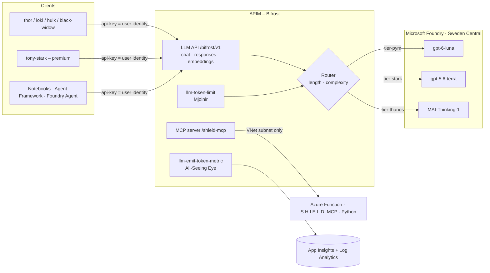

# 🌈 HEIMDAL – Azure API Management as an LLM & Agent Gateway

> 👁️ *"I see everything."* – Heimdall, guardian of the Bifrost

A demo showcase of **Azure API Management (APIM) as an AI gateway**: one endpoint for every model and agent tool, with

- 👤 **per-user token accounting**
- 🔀 a **configurable model router** (prompt length / prompt complexity)
- 🔨 **per-user token limits** (429 for one hero only)
- 🛡️ **MCP** exposure of Azure Function tools
- 🤖 **agents** (Foundry Agent Service, Agent Framework) running through the same gateway

Models run in **Microsoft Foundry** ☁️, infrastructure is **Bicep** 🦾 in **Sweden Central** 🇸🇪, custom code is **Python only** 🐍.
Public endpoints (demo); APIM's outbound VNet integration locks the MCP Function so only the gateway can reach it.

📚 **Docs:** [📖 story.md](story.md) – the notebooks as a story · [🌈 docs/apim-definition.md](docs/apim-definition.md) – what is set up in APIM · [🔍 docs/apim-integration.md](docs/apim-integration.md) – how it works · [🛡️ docs/user.md](docs/user.md) – how APIM identifies the user · [📊 docs/workbook.md](docs/workbook.md) – what the Azure workbook shows



## 📦 What's inside

| Path | Purpose |
|---|---|
| `infra/` | Bicep: network, monitoring, Foundry + model deployments, APIM, RBAC, Function app, APIs/products/subscriptions, Foundry connection |
| `infra/config/heimdal.json` | **Single source of truth** for models, tiers, router defaults, token limits and demo users (Bicep, scripts and notebooks read it) |
| `policies/bifrost-router.xml` | The brain: token limit → model routing → managed-identity call → token metrics → `x-heimdal-*` headers |
| `policies/bifrost-embeddings.xml` | `/embeddings`: no router, rate limit, embedding deployment, `Embedding Tokens` metric |
| `policies/shield-mcp.xml` | MCP rate limit + function key injection |
| `src/shield-mcp/` | Python Azure Function (MCP extension) with MCU tools |
| `azure.yaml`, `infra/azd/` | **Primary deploy path**: `azd up` entry point (subscription-scope wrapper + postdeploy hook `scripts/azd_hook.py`) |
| `scripts/deploy.py`, `teardown.py` | Python wrappers around `az` (alternative to azd); `azd_hook.py` is the azd postdeploy hook. Both write `.env` for the notebooks |
| `infra/workbooks/` | Azure Monitor workbook: token usage per user / model per user |
| `docs/` | [APIM definition](docs/apim-definition.md) and [integration deep dive](docs/apim-integration.md) |
| `notebooks/` | `00`–`08` demos (below), story in [story.md](story.md) |

### 🦸 Naming (MCU theme)
`rg-heimdal-asgard-swc` · `apim-heimdal-bifrost-*` · `vnet-heimdal-bifrost-*` · `fdry-heimdal-asgard-*` / `proj-heimdal-avengers-v2` · `*-allseeing-*` (monitoring) ·
`func-heimdal-shield-mcp-*` · products `avengers-initiative` / `infinity-gauntlet` · users `thor, loki, hulk, black-widow, tony-stark` ·
tiers `pym` / `stark` / `thanos`.

## 🚀 Deploy with `azd`

> 💡 **TL;DR:** `azd up` is the way to deploy. Set two values (`AZURE_LOCATION`, `HEIMDAL_PUBLISHER_EMAIL`), run `azd up`, wait ~20–40 min (APIM). The postdeploy hook writes `.env` for the notebooks.

**Prereqs:** [Azure Developer CLI](https://learn.microsoft.com/azure/developer/azure-developer-cli/install-azd) (`azd`), Azure CLI (`az`), Python 3.11+, permission to create APIM/Foundry/Function/VNet resources and role assignments, and quota for the models.
The postdeploy hook calls `az` and `python`, so sign in to both: `azd auth login` **and** `az login`.
The deployment grants the signed-in user *Azure AI User* (Foundry) and *Log Analytics Reader* for the notebooks.

```bash
pip install -r requirements.txt
azd auth login && az login
azd env new heimdal-dev
azd env set AZURE_LOCATION swedencentral          # required: model availability, see below
azd env set HEIMDAL_PUBLISHER_EMAIL you@contoso.com
azd up
```

`azd up` runs three steps:

| Step | 🔧 What happens |
|---|---|
| 1. provision | [infra/azd/main.bicep](infra/azd/main.bicep) creates `rg-heimdal-asgard-<env>` and deploys [infra/main.bicep](infra/main.bicep) into it |
| 2. deploy | Publishes the Python Function in [src/shield-mcp](src/shield-mcp) |
| 3. postdeploy | [scripts/azd_hook.py](scripts/azd_hook.py) injects the Function MCP key into the APIM named value `shield-mcp-key`, saves it as `HEIMDAL_MCP_KEY` and writes `.env` |

### 🎚️ azd parameters

Set with `azd env set <NAME> <value>`. Values are mapped to Bicep parameters in [infra/azd/main.parameters.json](infra/azd/main.parameters.json).

| 🔑 Variable | Bicep parameter | Set it? | Default | Meaning |
|---|---|---|---|---|
| `AZURE_ENV_NAME` | `environmentName` | ✅ by `azd env new` | – | Env name, max 32 chars. Becomes the resource group `rg-heimdal-asgard-<env>` |
| `AZURE_LOCATION` | `location` | ✅ **required** | – | Use `swedencentral` (models are verified there) |
| `HEIMDAL_PUBLISHER_EMAIL` | `publisherEmail` | ✅ **required** | – | APIM publisher e-mail |
| `HEIMDAL_ENABLE_MAI` | `enableMai` | optional | `false` | `true` deploys `MAI-Thinking-1` (needs quota, see below) |
| `AZURE_SUBSCRIPTION_ID` | – | ✅ asked by `azd up` | – | Target subscription |
| `AZURE_PRINCIPAL_ID` / `AZURE_PRINCIPAL_TYPE` | `principalId` / `principalType` | 🤖 azd fills it | empty / `User` | Gets the Foundry and Log Analytics data roles |
| `HEIMDAL_MCP_KEY` | `mcpKey` | 🤖 hook sets it | empty | Function MCP key; keeps `shield-mcp-key` intact on a later `azd provision`. Don't set it by hand |

Set at the end of provisioning (outputs, used by the hook): `AZURE_RESOURCE_GROUP`, `HEIMDAL_APIM_NAME`, `HEIMDAL_GATEWAY_URL`, `HEIMDAL_FOUNDRY_ACCOUNT`, `HEIMDAL_FOUNDRY_PROJECT`, `HEIMDAL_FOUNDRY_CONNECTION`, `HEIMDAL_FUNCTION_APP`, `HEIMDAL_APPINSIGHTS`, `HEIMDAL_LOG_WORKSPACE_ID`, `HEIMDAL_WORKBOOK_ID`.

> ⚠️ **Not an azd variable:** the APIM SKU (`StandardV2`), models, tiers, router defaults, token limits and demo users. Edit [infra/config/heimdal.json](infra/config/heimdal.json) (and `apimSku` in [infra/main.bicep](infra/main.bicep)), then run `azd provision` or `azd up` again.

> **Models** (verified against [Models sold directly by Azure](https://learn.microsoft.com/azure/foundry/foundry-models/concepts/models-sold-directly-by-azure)): `gpt-6-luna` version `2026-09-22`, `gpt-5.6-terra` version `2026-07-09`, `gpt-6.1-sol` version `2026-09-29`, `text-embedding-3-small` version `1` (for `/embeddings`), `MAI-Thinking-1` (preview, format `Microsoft`) version `2026-06-01`, all `GlobalStandard` in Sweden Central.
> MAI-Thinking-1 is served on `/mai/v1` (not `/openai/v1`) and needs `max_completion_tokens`; the router handles both via the `mai-deployments` named value.

#### 🧠 MAI-Thinking-1 quota (optional top tier)
`MAI-Thinking-1` has **0 default quota**, so it is **off by default**: the `thanos` tier falls back to `gpt-6.1-sol`.
1. Request quota: Foundry portal → **Manage → Quota** → pick the model/region (Sweden Central, GlobalStandard) → **Request quota**, or use the [quota request form](https://aka.ms/oai/stuquotarequest). Needs Owner/Contributor on the subscription; approval can take days, and allow ~15 min to propagate.
2. Once approved: `azd env set HEIMDAL_ENABLE_MAI true`, then `azd provision`. The router then maps `thanos` → `mai-thinking-1` automatically.

### 🔁 Day-2 commands

| Command | Does |
|---|---|
| `azd provision` | Re-apply the Bicep (after editing `heimdal.json`) |
| `azd deploy` | Re-publish the Function only |
| `azd env get-values` | Show all values above |
| `azd down --purge` | 🧹 Delete everything (purge frees the soft-deleted Foundry account) |

### 🛠️ Alternative: Python scripts (no azd)

Same Bicep, driven by [scripts/deploy.py](scripts/deploy.py) and `az`. Writes the same `.env`. It reads `HEIMDAL_PUBLISHER_EMAIL` / `HEIMDAL_ENABLE_MAI` from the shell environment and uses the fixed resource group `rg-heimdal-asgard-swc`.

```bash
pip install -r requirements.txt
python scripts/deploy.py --check-models                # are the models in swedencentral?
python scripts/deploy.py --email you@contoso.com       # ~20-40 min (APIM), writes .env
python scripts/teardown.py                             # remove it again
```

## 🎬 Demo flow (notebooks)

The full narrative is in [story.md](story.md).

| # | Notebook | Shows |
|---|---|---|
| 00 ⚡ | `00_setup_asgard` | Architecture, deploy, env check |
| 01 🌈 | `01_bifrost_basic_call` | OpenAI-compatible gateway call, routing headers, Responses API + embeddings |
| 02 👁️ | `02_all_seeing_eye_usage` | **Token usage per user** (custom metrics + LLM gateway logs, KQL) |
| 03 📏 | `03_router_prompt_length` | Router by **prompt length**, client overrides |
| 04 🧠 | `04_router_complexity` | Router by **prompt complexity** – heuristic vs LLM classifier, live reconfig |
| 05 🔨 | `05_mjolnir_token_limits` | Per-user TPM limits, 429 for one user only |
| 06 🛡️ | `06_shield_mcp_via_bifrost` | **MCP** server (Azure Function) governed by APIM |
| 07 🤖 | `07_foundry_agent_via_bifrost` | **Foundry Agent Service** using the gateway as its model |
| 08 🦸 | `08_agent_framework_via_bifrost` | **Agent Framework** agent: LLM + MCP tools, both via APIM |

## 🎛️ Router configuration

APIM **named values** (change in portal, `set_router(...)` in notebooks, or Bicep param `router`):

| Named value | Values | Meaning |
|---|---|---|
| `router-mode` | `length` \| `complexity` \| `hybrid` | which signal(s) decide; hybrid = higher tier wins |
| `length-threshold-tokens` | e.g. `500` | est. prompt tokens (chars/4): `<T` pym, `<4T` stark, else thanos |
| `complexity-mode` | `heuristic` \| `llm` | policy scoring vs small-model classifier (falls back to heuristic) |
| `complexity-threshold` | e.g. `3` | score for stark; `2×` for thanos |
| `model-tier-pym/stark/thanos`, `model-classifier` | deployment names | tier → model mapping |
| `tpm-standard`, `tpm-premium` | e.g. `5000` | tokens per minute per user by product |

Full list of what is defined in APIM: [docs/apim-definition.md](docs/apim-definition.md).

Clients may also force `model="tier-thanos"` or a concrete deployment name; `model="heimdal-auto"` / `"auto"` (or omitted) routes automatically – including the LLM classifier when `complexity-mode=llm`.
Routing applies to `POST /chat/completions` and `POST /responses`; `POST /embeddings` maps `heimdal-auto` to `model-embedding`.

## ⚠️ Known notes / caveats
- 📊 **Token metrics** (dimensions `User`, `Model`, `Tier`, `Agent` via the `x-agent` header, `API ID`) require *Custom metrics with dimensions* on the App Insights resource (Usage & estimated costs → Custom metrics → With dimensions; usually default for new workspace-based resources). For streaming, send `stream_options={"include_usage": true}`.
- ⏱️ Logs/metrics lag a few minutes. The LLM logs table (`ApiManagementGatewayLlmLog`) gives exact per-request tokens and model.
- 🔌 MCP is a plain HTTP API in APIM (streamable HTTP forwarded unbuffered; the preview `type: mcp` API returned 500 here). The Function MCP extension needs the `mcp_extension` system key; the azd hook (or `deploy.py`) injects it into the `shield-mcp-key` named value after code publish and passes it to later deployments (`mcpKey` parameter).
- 🔒 The Function only accepts traffic from APIM's outbound VNet subnet (access restrictions); calling it directly returns 403.
- 🔑 Send subscription keys in the `api-key` header – keys in the URL (`?subscription-key=`) are rejected with 400.
- 🧪 Foundry connection (notebook 07) and Agent Framework (notebook 08) use preview SDK/APIs – adjust to current docs if signatures changed.
- 🔓 This is a demo: public gateway endpoint and subscription keys. Harden (Entra/JWT auth, private endpoints, Key Vault named values) for real use.
