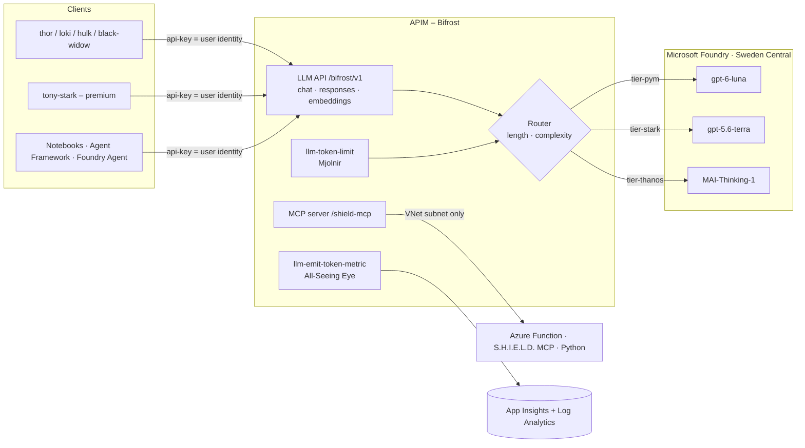

# 🌈 HEIMDAL – Azure API Management as an LLM & Agent Gateway

> 👁️ *"I see everything."* – Heimdall, guardian of the Bifrost

A demo showcase of **Azure API Management (APIM) as an AI gateway**: one endpoint for every model and agent tool, with

- 👤 **per-user token accounting**
- 🔀 a **configurable model router** (prompt length / prompt complexity)
- 🔨 **per-user token limits** (429 for one hero only)
- 🛡️ **MCP** exposure of Azure Function tools
- 🤖 **agents** (Foundry Agent Service, Agent Framework) running through the same gateway

Models run in **Microsoft Foundry** ☁️, infrastructure is **Bicep** 🦾 in **Sweden Central** 🇸🇪, custom code is **Python only** 🐍.
Public endpoints (demo); APIM's outbound VNet integration locks the MCP Function so only the gateway can reach it.

📚 **Docs:** [📖 story.md](story.md) – the notebooks as a story · [🌈 docs/apim-definition.md](docs/apim-definition.md) – what is set up in APIM · [🔍 docs/apim-integration.md](docs/apim-integration.md) – how it works



## 📦 What's inside

| Path | Purpose |
|---|---|
| `infra/` | Bicep: network, monitoring, Foundry + model deployments, APIM, RBAC, Function app, APIs/products/subscriptions, Foundry connection |
| `infra/config/heimdal.json` | **Single source of truth** for models, tiers, router defaults, token limits and demo users (Bicep, scripts and notebooks read it) |
| `policies/bifrost-router.xml` | The brain: token limit → model routing → managed-identity call → token metrics → `x-heimdal-*` headers |
| `policies/bifrost-embeddings.xml` | `/embeddings`: no router, rate limit, embedding deployment, `Embedding Tokens` metric |
| `policies/shield-mcp.xml` | MCP rate limit + function key injection |
| `src/shield-mcp/` | Python Azure Function (MCP extension) with MCU tools |
| `azure.yaml`, `infra/azd/` | `azd up` entry point (subscription-scope wrapper, preprovision hook `scripts/ollama_tunnel.py`, postdeploy hook `scripts/azd_hook.py`) |
| `scripts/deploy.py`, `teardown.py` | Python wrappers around `az` (alternative to azd); write `.env` for the notebooks |
| `infra/workbooks/` | Azure Monitor workbook: token usage per user / model per user |
| `docs/` | [APIM definition](docs/apim-definition.md) and [integration deep dive](docs/apim-integration.md) |
| `notebooks/` | `00`–`08` demos (below), story in [story.md](story.md) |

### 🦸 Naming (MCU theme)
`rg-heimdal-asgard-swc` · `apim-heimdal-bifrost-*` · `vnet-heimdal-bifrost-*` · `fdry-heimdal-asgard-*` / `proj-heimdal-avengers-v2` · `*-allseeing-*` (monitoring) ·
`func-heimdal-shield-mcp-*` · products `avengers-initiative` / `infinity-gauntlet` · users `thor, loki, hulk, black-widow, tony-stark` ·
tiers `pym` / `stark` / `thanos`.

## 🚀 Deploy

Prereqs: Azure CLI (`az login`), Python 3.11+, permission to create APIM/Foundry/Function/VNet resources and role assignments, quota for the models.
The deployment grants the signed-in user *Azure AI User* (Foundry) and *Log Analytics Reader* for the notebooks.

```bash
pip install -r requirements.txt
python scripts/deploy.py --check-models                # are the models in swedencentral? (edit infra/config/heimdal.json)
python scripts/deploy.py --email you@contoso.com       # ~20-40 min (APIM), writes .env
```

> **Models** (verified against [Models sold directly by Azure](https://learn.microsoft.com/azure/foundry/foundry-models/concepts/models-sold-directly-by-azure)): `gpt-6-luna` version `2026-09-22`, `gpt-5.6-terra` version `2026-07-09`, `gpt-6.1-sol` version `2026-09-29`, `text-embedding-3-small` version `1` (for `/embeddings`), `MAI-Thinking-1` (preview, format `Microsoft`) version `2026-06-01`, all `GlobalStandard` in Sweden Central.
> MAI-Thinking-1 is served on `/mai/v1` (not `/openai/v1`) and needs `max_completion_tokens`; the router handles both via the `mai-deployments` named value. Its default quota tier can be 0 TPM – request quota if deployment fails.
> Edit `models` / `tierModels` in `infra/config/heimdal.json` to use other deployments – both `deploy.py` and `azd` pick it up.

#### 🧠 MAI-Thinking-1 quota (optional top tier)
`MAI-Thinking-1` has **0 default quota**, so it is **off by default**: the `thanos` tier falls back to `gpt-6.1-sol`.
1. Request quota: Foundry portal → **Manage → Quota** → pick the model/region (Sweden Central, GlobalStandard) → **Request quota**, or use the [quota request form](https://aka.ms/oai/stuquotarequest). Needs Owner/Contributor on the subscription; approval can take days, and allow ~15 min to propagate.
2. Once approved, enable it: `export HEIMDAL_ENABLE_MAI=true` (scripts) or `azd env set HEIMDAL_ENABLE_MAI true`, then redeploy. The router then maps `thanos` → `mai-thinking-1` automatically.

### ⚡ Or deploy with `azd` (Azure Developer CLI)

```bash
azd auth login
azd env new heimdal-dev
azd env set AZURE_LOCATION swedencentral   # required: azd uses it as the deployment location
azd env set HEIMDAL_PUBLISHER_EMAIL you@contoso.com
azd up        # provisions infra/azd -> infra/main.bicep, deploys src/shield-mcp, postdeploy hook wires the MCP key + writes .env
```

`azd down --purge` removes everything. `azd` creates the resource group `rg-heimdal-asgard-<env>`.
The postdeploy hook stores the Function MCP key as `HEIMDAL_MCP_KEY` in the azd environment, so a later `azd provision`
keeps the `shield-mcp-key` named value intact.

### 🦙 Local Ollama via ngrok (optional)

Serve a model from **your own machine** through the gateway, next to the Foundry models. Requests with that model
name go through APIM → ngrok → your local Ollama, with the same keys, token limits, metrics and `x-heimdal-*` headers.

Prereqs: [Ollama](https://ollama.com/download) and [ngrok](https://ngrok.com/download) installed, plus
`ngrok config add-authtoken <token>` once ([free account](https://dashboard.ngrok.com/get-started/your-authtoken)).

```bash
azd env set HEIMDAL_ENABLE_OLLAMA true
azd env set HEIMDAL_OLLAMA_MODEL llama3.2               # any model from ollama.com/library, comma-separated for several
# azd env set HEIMDAL_OLLAMA_NGROK_DOMAIN you.ngrok-free.app   # optional fixed domain
azd up                                                  # or azd provision
```

The `preprovision` hook (`scripts/ollama_tunnel.py`) does the following:
- checks that `ollama` is installed, starts `ollama serve` if nothing answers on `:11434`, and runs `ollama pull` for missing models;
- checks that `ngrok` is installed and configured, and starts `ngrok http 11434` if no tunnel exists;
- protects the tunnel with an ngrok traffic policy: **basic auth** (a generated secret, stored as `HEIMDAL_OLLAMA_AUTH` in the azd env) and a Host rewrite;
- verifies the tunnel (401 without credentials, model list with credentials) and stores `HEIMDAL_OLLAMA_URL` / `HEIMDAL_OLLAMA_MODELS` for Bicep.

Bicep then adds the `asgard-ollama` backend and the `ollama-models` / `ollama-basic-auth` named values.

```python
ask("Who guards the Bifrost?", user="thor", model="llama3.2")   # x-heimdal-route-reason: local-ollama;...
```

- 🔁 **The tunnel URL changes when ngrok restarts** (unless you set a fixed domain). Re-run `azd provision` and the hook picks up the new URL.
- 🛑 `python scripts/ollama_tunnel.py --stop` stops the `ollama` / `ngrok` processes the hook started. Logs and the generated policy are in `.azure/<env>/` (`.ollama-tunnel/` without azd).
- 📶 Your machine must stay on, and the free ngrok plan has a monthly transfer cap. Local inference is slow compared to Foundry.
- Non-azd: `HEIMDAL_ENABLE_OLLAMA=true python scripts/deploy.py --email ...` runs the same checks.

🧹 Teardown (non-azd): `python scripts/teardown.py`.

## 🎬 Demo flow (notebooks)

The full narrative is in [story.md](story.md).

| # | Notebook | Shows |
|---|---|---|
| 00 ⚡ | `00_setup_asgard` | Architecture, deploy, env check |
| 01 🌈 | `01_bifrost_basic_call` | OpenAI-compatible gateway call, routing headers, Responses API + embeddings |
| 02 👁️ | `02_all_seeing_eye_usage` | **Token usage per user** (custom metrics + LLM gateway logs, KQL) |
| 03 📏 | `03_router_prompt_length` | Router by **prompt length**, client overrides |
| 04 🧠 | `04_router_complexity` | Router by **prompt complexity** – heuristic vs LLM classifier, live reconfig |
| 05 🔨 | `05_mjolnir_token_limits` | Per-user TPM limits, 429 for one user only |
| 06 🛡️ | `06_shield_mcp_via_bifrost` | **MCP** server (Azure Function) governed by APIM |
| 07 🤖 | `07_foundry_agent_via_bifrost` | **Foundry Agent Service** using the gateway as its model |
| 08 🦸 | `08_agent_framework_via_bifrost` | **Agent Framework** agent: LLM + MCP tools, both via APIM |

## 🎛️ Router configuration

APIM **named values** (change in portal, `set_router(...)` in notebooks, or Bicep param `router`):

| Named value | Values | Meaning |
|---|---|---|
| `router-mode` | `length` \| `complexity` \| `hybrid` | which signal(s) decide; hybrid = higher tier wins |
| `length-threshold-tokens` | e.g. `500` | est. prompt tokens (chars/4): `<T` pym, `<4T` stark, else thanos |
| `complexity-mode` | `heuristic` \| `llm` | policy scoring vs small-model classifier (falls back to heuristic) |
| `complexity-threshold` | e.g. `3` | score for stark; `2×` for thanos |
| `model-tier-pym/stark/thanos`, `model-classifier` | deployment names | tier → model mapping |
| `tpm-standard`, `tpm-premium` | e.g. `5000` | tokens per minute per user by product |
| `ollama-models` | `none` or e.g. `llama3.2` | models routed to the local Ollama via ngrok (set by the hook; point a `model-tier-*` at one to route a whole tier locally) |

Full list of what is defined in APIM: [docs/apim-definition.md](docs/apim-definition.md).

Clients may also force `model="tier-thanos"` or a concrete deployment name; `model="heimdal-auto"` / `"auto"` (or omitted) routes automatically – including the LLM classifier when `complexity-mode=llm`.
Routing applies to `POST /chat/completions` and `POST /responses`; `POST /embeddings` maps `heimdal-auto` to `model-embedding`.

## ⚠️ Known notes / caveats
- 📊 **Token metrics** (dimensions `User`, `Model`, `Tier`, `Agent` via the `x-agent` header, `API ID`) require *Custom metrics with dimensions* on the App Insights resource (Usage & estimated costs → Custom metrics → With dimensions; usually default for new workspace-based resources). For streaming, send `stream_options={"include_usage": true}`.
- ⏱️ Logs/metrics lag a few minutes. The LLM logs table (`ApiManagementGatewayLlmLog`) gives exact per-request tokens and model.
- 🔌 MCP is a plain HTTP API in APIM (streamable HTTP forwarded unbuffered; the preview `type: mcp` API returned 500 here). The Function MCP extension needs the `mcp_extension` system key; `deploy.py` / the azd hook inject it into the `shield-mcp-key` named value after code publish and pass it to later deployments (`mcpKey` parameter).
- 🔒 The Function only accepts traffic from APIM's outbound VNet subnet (access restrictions); calling it directly returns 403.
- 🔑 Send subscription keys in the `api-key` header – keys in the URL (`?subscription-key=`) are rejected with 400.
- 🧪 Foundry connection (notebook 07) and Agent Framework (notebook 08) use preview SDK/APIs – adjust to current docs if signatures changed.
- 🔓 This is a demo: public gateway endpoint and subscription keys. Harden (Entra/JWT auth, private endpoints, Key Vault named values) for real use.
