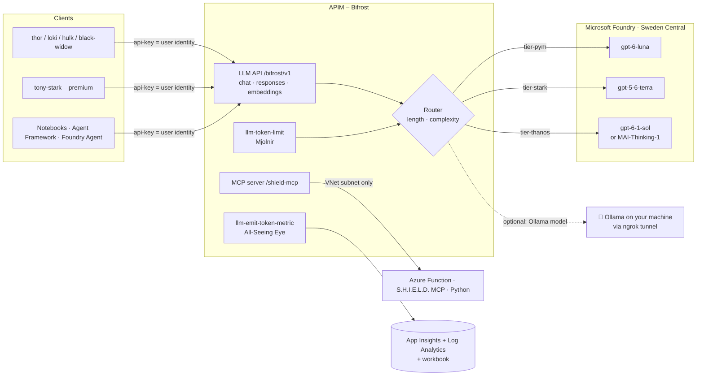

# 🌈 HEIMDAL – Azure API Management as an LLM & Agent Gateway

> 👁️ *"I see everything."* – Heimdall, guardian of the Bifrost

> 💡 **TL;DR:** A **showcase and playground** for experimenting with **Azure API Management (APIM) as an LLM gateway**. One `azd up` deploys a complete gateway in front of Microsoft Foundry models. Ten notebooks then show, one feature at a time, what APIM can do for LLM traffic. Most behaviour is driven by APIM named values, so you can change it live and watch the effect. **It is a demo, not a production template.**

One endpoint for every model and agent tool, with

- 👤 **per-user token accounting**: every call is attributed to a user (APIM subscription)
- 🔀 a **configurable model router** by prompt length and/or prompt complexity
- 🔨 **per-user token limits**: a 429 for one hero only, while the others keep working
- 📊 **observability**: token metrics, LLM gateway logs and an Azure Monitor workbook
- 🛡️ **MCP** exposure of Azure Function tools
- 🤖 **agents** (Foundry Agent Service, Agent Framework) running through the same gateway
- 🦙 *(optional)* a **local model** on your own machine (Ollama via ngrok) behind the same gateway

Models run in **Microsoft Foundry** ☁️, infrastructure is **Bicep** 🦾 in **Sweden Central** 🇸🇪, custom code is **Python only** 🐍.

| 🧪 This repo is | 🚫 This repo is not |
|---|---|
| A working end-to-end example you can deploy in one command | A hardened landing zone or production template |
| A playground: change router modes, limits and models at runtime | Cost-optimised: APIM StandardV2 and Foundry bill while deployed |
| Notebooks that explain each APIM LLM feature step by step | Secured for real users: public endpoints, subscription keys as identity |

📚 **Docs:** [📖 story.md](story.md) – the notebooks as a story · [🌈 docs/apim-definition.md](docs/apim-definition.md) – what is set up in APIM · [🔍 docs/apim-integration.md](docs/apim-integration.md) – how it works · [🛡️ docs/user.md](docs/user.md) – how APIM identifies the user · [📊 docs/workbook.md](docs/workbook.md) – what the Azure workbook shows · [🦙 docs/local-ollama.md](docs/local-ollama.md) – the optional local Ollama backend in detail

---

## 🗺️ The big picture



Every client only knows the gateway URL and its own key. The gateway picks the model, calls the backend with its own identity, enforces the token budget and records who used what.

---

## 🧪 What you can try

| ❓ Question to explore | 📓 Notebook | 🎛️ What to change |
|---|---|---|
| How does a client call models through APIM? | `01_bifrost_basic_call` | `model="heimdal-auto"`, a tier, or a deployment name |
| Who used how many tokens? | `02_all_seeing_eye_usage` | nothing, just look: KQL and the [workbook](docs/workbook.md) |
| Can the gateway pick the model by prompt size? | `03_router_prompt_length` | named values `router-mode=length`, `length-threshold-tokens` |
| …or by prompt difficulty? | `04_router_complexity` | `router-mode=complexity`, `complexity-mode=heuristic\|llm` |
| Can one user be throttled without hurting others? | `05_mjolnir_token_limits` | `tpm-standard`, `tpm-premium` |
| Can APIM govern MCP tools too? | `06_shield_mcp_via_bifrost` | MCP rate limit in [shield-mcp.xml](policies/shield-mcp.xml) |
| Do agents work through the gateway? | `07_foundry_agent_via_bifrost`, `08_agent_framework_via_bifrost` | the `x-agent` header to tag traffic |
| Can a local model join the same gateway, even for Foundry agents? | `09_local_ollama_via_bifrost` | `HEIMDAL_ENABLE_OLLAMA`, `ollama-models`, a `model-tier-*` pointing to it, an agent on `bifrost-apim/<local model>` |

> 💡 Router settings are **APIM named values**. Change them in the portal or with `set_router(...)` from the notebooks: no redeploy, effective within about a minute. See **🎛️ Router configuration** below.

---

## 🚀 Deploy with `azd`

> 💡 **TL;DR:** `azd up` is the way to deploy. Set two values (`AZURE_LOCATION`, `HEIMDAL_PUBLISHER_EMAIL`), run `azd up`, wait ~20–40 min (APIM). The postdeploy hook writes `.env` for the notebooks.

**Prereqs:** [Azure Developer CLI](https://learn.microsoft.com/azure/developer/azure-developer-cli/install-azd) (`azd`), Azure CLI (`az`), Python 3.11+, permission to create APIM/Foundry/Function/VNet resources and role assignments, and quota for the models.
The postdeploy hook calls `az` and `python`, so sign in to both: `azd auth login` **and** `az login`.
The deployment grants the signed-in user *Azure AI User* (Foundry) and *Log Analytics Reader* for the notebooks.

```bash
python -m venv .venv                              # then activate it: .venv\Scripts\activate (Windows) or source .venv/bin/activate
pip install -r requirements.txt
azd auth login && az login
azd env new dev
azd env set AZURE_LOCATION swedencentral          # required: model availability, see below
azd env set HEIMDAL_PUBLISHER_EMAIL you@contoso.com
azd up
```

`azd up` runs these steps:

| Step | 🔧 What happens |
|---|---|
| 0. preprovision | [scripts/ollama_tunnel.py](scripts/ollama_tunnel.py) prepares the optional local Ollama + ngrok tunnel. Does nothing unless `HEIMDAL_ENABLE_OLLAMA=true` |
| 1. provision | [infra/azd/main.bicep](infra/azd/main.bicep) creates `rg-hmdl-<env>` and deploys [infra/main.bicep](infra/main.bicep) into it |
| 2. deploy | Publishes the Python Function in [src/shield-mcp](src/shield-mcp) |
| 3. postdeploy | [scripts/azd_hook.py](scripts/azd_hook.py) injects the Function MCP key into the APIM named value `shield-mcp-key`, saves it as `HEIMDAL_MCP_KEY` and writes `.env` |

> ⚠️ **Costs:** APIM StandardV2, Foundry deployments, the Function and Log Analytics are billed while deployed. Remove everything after experimenting with `azd down --purge`.

### 🎚️ azd parameters

Set with `azd env set <NAME> <value>`. Values are mapped to Bicep parameters in [infra/azd/main.parameters.json](infra/azd/main.parameters.json).

| 🔑 Variable | Bicep parameter | Set it? | Default | Meaning |
|---|---|---|---|---|
| `AZURE_ENV_NAME` | `environmentName` | ✅ by `azd env new` | – | Env name, max 32 chars. Becomes the resource group `rg-hmdl-<env>` |
| `AZURE_LOCATION` | `location` | ✅ **required** | – | Use `swedencentral` (models are verified there) |
| `HEIMDAL_PUBLISHER_EMAIL` | `publisherEmail` | ✅ **required** | – | APIM publisher e-mail |
| `HEIMDAL_ENABLE_MAI` | `enableMai` | optional | `false` | `true` deploys `MAI-Thinking-1` (needs quota, see below) |
| `HEIMDAL_ENABLE_OLLAMA` | `enableOllama` | optional | `false` | `true` adds the local Ollama backend via ngrok (see [below](#-local-ollama-via-ngrok-optional)) |
| `HEIMDAL_OLLAMA_MODEL` | – (hook) | optional | `gemma4:e4b` | Ollama model(s) to serve, comma-separated. Served as `gemma4-e4b` (Foundry-safe name) |
| `HEIMDAL_OLLAMA_NGROK_DOMAIN` | – (hook) | optional | empty | Fixed ngrok domain; empty = the URL ngrok assigns |
| `AZURE_SUBSCRIPTION_ID` | – | ✅ asked by `azd up` | – | Target subscription |
| `AZURE_PRINCIPAL_ID` / `AZURE_PRINCIPAL_TYPE` | `principalId` / `principalType` | 🤖 azd fills it | empty / `User` | Gets the Foundry and Log Analytics data roles |
| `HEIMDAL_MCP_KEY` | `mcpKey` | 🤖 hook sets it | empty | Function MCP key; keeps `shield-mcp-key` intact on a later `azd provision`. Don't set it by hand |
| `HEIMDAL_OLLAMA_URL` / `HEIMDAL_OLLAMA_MODELS` / `HEIMDAL_OLLAMA_AUTH` | `ollamaUrl` / `ollamaModels` / `ollamaAuth` | 🤖 Ollama hook sets them | empty | Tunnel URL, served models and the tunnel's basic-auth secret. Don't set them by hand |

Set at the end of provisioning (outputs, used by the hook): `AZURE_RESOURCE_GROUP`, `HEIMDAL_APIM_NAME`, `HEIMDAL_GATEWAY_URL`, `HEIMDAL_FOUNDRY_ACCOUNT`, `HEIMDAL_FOUNDRY_PROJECT`, `HEIMDAL_FOUNDRY_CONNECTION`, `HEIMDAL_FUNCTION_APP`, `HEIMDAL_APPINSIGHTS`, `HEIMDAL_LOG_WORKSPACE_ID`, `HEIMDAL_WORKBOOK_ID`, `HEIMDAL_OLLAMA_ENABLED`.

> ⚠️ **Not an azd variable:** the APIM SKU (`StandardV2`), models, tiers, router defaults, token limits and demo users. Edit [infra/config/heimdal.json](infra/config/heimdal.json) (and `apimSku` in [infra/main.bicep](infra/main.bicep)), then run `azd provision` or `azd up` again.

> **Models** (verified against [Models sold directly by Azure](https://learn.microsoft.com/azure/foundry/foundry-models/concepts/models-sold-directly-by-azure)): `gpt-6-luna` version `2026-09-22`, `gpt-5.6-terra` version `2026-07-09`, `gpt-6.1-sol` version `2026-09-29`, `text-embedding-3-small` version `1` (for `/embeddings`), `MAI-Thinking-1` (preview, format `Microsoft`) version `2026-06-01`, all `GlobalStandard` in Sweden Central.
> MAI-Thinking-1 is served on `/mai/v1` (not `/openai/v1`) and needs `max_completion_tokens`; the router handles both via the `mai-deployments` named value.

#### 🧠 MAI-Thinking-1 quota (optional top tier)
`MAI-Thinking-1` has **0 default quota**, so it is **off by default**: the `thanos` tier falls back to `gpt-6.1-sol`.
1. Request quota: Foundry portal → **Manage → Quota** → pick the model/region (Sweden Central, GlobalStandard) → **Request quota**, or use the [quota request form](https://aka.ms/oai/stuquotarequest). Needs Owner/Contributor on the subscription; approval can take days, and allow ~15 min to propagate.
2. Once approved: `azd env set HEIMDAL_ENABLE_MAI true`, then `azd provision`. The router then maps `thanos` → `mai-thinking-1` automatically.

### 🦙 Local Ollama via ngrok (optional)

> 💡 **TL;DR:** Serve a model from **your own machine** through the gateway, next to the Foundry models. Set `HEIMDAL_ENABLE_OLLAMA=true` and a model, run `azd up`. Calls with that model name go APIM → ngrok → your Ollama, with the same keys, token limits, metrics and `x-heimdal-*` headers.

**Prereqs:** [Ollama](https://ollama.com/download) and [ngrok](https://ngrok.com/download) installed, plus `ngrok config add-authtoken <token>` once ([free account](https://dashboard.ngrok.com/get-started/your-authtoken)).

```bash
azd env set HEIMDAL_ENABLE_OLLAMA true
azd env set HEIMDAL_OLLAMA_MODEL gemma4:e4b                   # default; any model from ollama.com/library, comma-separated for several
# azd env set HEIMDAL_OLLAMA_NGROK_DOMAIN you.ngrok-free.app  # optional fixed domain
azd up                                                        # or azd provision
```

What the `preprovision` hook ([scripts/ollama_tunnel.py](scripts/ollama_tunnel.py)) does:

| Step | 🔧 What happens |
|---|---|
| 🦙 Ollama | Checks that `ollama` is installed, starts `ollama serve` if nothing answers on `:11434`, runs `ollama pull` for missing models, serves tagged models under a name without `:` (`gemma4:e4b` → `gemma4-e4b`, as Foundry requires) |
| 🚇 ngrok | Checks that `ngrok` is installed and configured, starts `ngrok http 11434` if no tunnel exists |
| 🔒 Protect | ngrok traffic policy: **basic auth** (a generated secret, stored as `HEIMDAL_OLLAMA_AUTH`) and a Host rewrite to `localhost` |
| ✅ Verify | 401 without credentials, model list with credentials. Stores `HEIMDAL_OLLAMA_URL` / `HEIMDAL_OLLAMA_MODELS` for Bicep |

Bicep then adds the `asgard-ollama` backend and the `ollama-models` / `ollama-basic-auth` named values.

```python
ask("Who guards the Bifrost?", user="thor", model="gemma4-e4b",
    max_completion_tokens=400, reasoning_effort="none")   # x-heimdal-route-reason: local-ollama;...
```

📖 How it works in detail, requirements and troubleshooting: [docs/local-ollama.md](docs/local-ollama.md). The full walkthrough is notebook [`09_local_ollama_via_bifrost`](notebooks/09_local_ollama_via_bifrost.ipynb).

- 🔁 **The tunnel URL changes when ngrok restarts** (unless you set a fixed domain). Run `azd provision` again and the hook picks up the new URL.
- 🔢 Send `max_completion_tokens`. The gateway renames it to `max_tokens` for Ollama, which only honours that one.
- 🧠 The default `gemma4:e4b` (6.6 GB) answers directly. Reasoning models (`qwen3.5`, `deepseek-r1`) think first: if the answer is empty, the token budget went into thinking, send `reasoning_effort="none"`.
- 🪵 **Is the local model used?** Every call's backend is in `ApiManagementGatewayLogs.BackendId` (`asgard-ollama`). See [docs/workbook.md](docs/workbook.md) section 8, or `KQL_CALLS_BY_BACKEND` in `notebooks/heimdal_helpers.py`.
- 🛑 `python scripts/ollama_tunnel.py --stop` stops the `ollama` / `ngrok` processes the hook started. Logs and the generated policy are in `.azure/<env>/` (`.ollama-tunnel/` without azd).
- 📶 Your machine must stay on, and the free ngrok plan has a monthly transfer cap. Local inference is slower than Foundry.
- 🛠️ Without azd: `HEIMDAL_ENABLE_OLLAMA=true python scripts/deploy.py --email ...` runs the same checks.

### 🔁 Day-2 commands

| Command | Does |
|---|---|
| `azd provision` | Re-apply the Bicep (after editing `heimdal.json`, or when the ngrok URL changed) |
| `azd deploy` | Re-publish the Function only |
| `azd env get-values` | Show all values above |
| `python scripts/ollama_tunnel.py --stop` | Stop the local Ollama / ngrok processes started by the hook |
| `azd down --purge` | 🧹 Delete everything (purge frees the soft-deleted Foundry account) |

### 🛠️ Alternative: Python scripts (no azd)

Same Bicep, driven by [scripts/deploy.py](scripts/deploy.py) and `az`. Writes the same `.env`. It reads `HEIMDAL_PUBLISHER_EMAIL` / `HEIMDAL_ENABLE_MAI` / `HEIMDAL_ENABLE_OLLAMA` from the shell environment and uses the fixed resource group `rg-hmdl-dev`.

```bash
pip install -r requirements.txt
python scripts/deploy.py --check-models                # are the models in swedencentral?
python scripts/deploy.py --email you@contoso.com       # ~20-40 min (APIM), writes .env
python scripts/teardown.py                             # remove it again
```

---

## 🎬 Demo flow (notebooks)

The full narrative is in [story.md](story.md). Run the notebooks in order, starting with `00`.

> 💡 **Running them:** open `notebooks/` in VS Code (or Jupyter) and select the `.venv` from the deploy step as kernel. The notebooks read `.env` from the repo root, which `azd up` wrote. A *"requires the ipykernel package"* message means a global Python is selected instead of `.venv`.

| # | Notebook | Shows |
|---|---|---|
| 00 ⚡ | `00_setup_asgard` | Architecture, deploy, env check |
| 01 🌈 | `01_bifrost_basic_call` | OpenAI-compatible gateway call, routing headers, Responses API + embeddings |
| 02 👁️ | `02_all_seeing_eye_usage` | **Token usage per user** (custom metrics + LLM gateway logs, KQL) |
| 03 📏 | `03_router_prompt_length` | Router by **prompt length**, client overrides |
| 04 🧠 | `04_router_complexity` | Router by **prompt complexity** – heuristic vs LLM classifier, live reconfig |
| 05 🔨 | `05_mjolnir_token_limits` | Per-user TPM limits, 429 for one user only |
| 06 🛡️ | `06_shield_mcp_via_bifrost` | **MCP** server (Azure Function) governed by APIM |
| 07 🤖 | `07_foundry_agent_via_bifrost` | **Foundry Agent Service** using the gateway as its model |
| 08 🦸 | `08_agent_framework_via_bifrost` | **Agent Framework** agent: LLM + MCP tools, both via APIM |
| 09 🦙 | `09_local_ollama_via_bifrost` | *(optional)* **Local Ollama via ngrok**: local vs Foundry, streaming, locked tunnel, a tier routed to the laptop, a Foundry agent on the local model |

---

## 🎛️ Router configuration

APIM **named values** (change in portal, `set_router(...)` in notebooks, or Bicep param `router`):

| Named value | Values | Meaning |
|---|---|---|
| `router-mode` | `length` \| `complexity` \| `hybrid` | which signal(s) decide; hybrid = higher tier wins |
| `length-threshold-tokens` | e.g. `500` | est. prompt tokens (chars/4): `<T` pym, `<4T` stark, else thanos |
| `complexity-mode` | `heuristic` \| `llm` | policy scoring vs small-model classifier (falls back to heuristic) |
| `complexity-threshold` | e.g. `3` | score for stark; `2×` for thanos |
| `model-tier-pym/stark/thanos`, `model-classifier` | deployment names | tier → model mapping |
| `tpm-standard`, `tpm-premium` | e.g. `5000` | tokens per minute per user by product |
| `ollama-models` | `none` or e.g. `gemma4-e4b` | models routed to the local Ollama via ngrok (set by the hook; point a `model-tier-*` at one to route a whole tier locally) |

Full list of what is defined in APIM: [docs/apim-definition.md](docs/apim-definition.md).

Clients may also force `model="tier-thanos"` or a concrete deployment name; `model="heimdal-auto"` / `"auto"` (or omitted) routes automatically – including the LLM classifier when `complexity-mode=llm`.
Routing applies to `POST /chat/completions` and `POST /responses`; `POST /embeddings` maps `heimdal-auto` to `model-embedding`.

---

## 📦 What's inside

| Path | Purpose |
|---|---|
| `infra/` | Bicep: network, monitoring, Foundry + model deployments, APIM, RBAC, Function app, APIs/products/subscriptions, Foundry connection |
| `infra/config/heimdal.json` | **Single source of truth** for models, tiers, router defaults, token limits and demo users (Bicep, scripts and notebooks read it) |
| `policies/bifrost-router.xml` | The brain: token limit → model routing → backend call (managed identity, or basic auth for Ollama) → token metrics → `x-heimdal-*` headers |
| `policies/bifrost-embeddings.xml` | `/embeddings`: no router, rate limit, embedding deployment, `Embedding Tokens` metric |
| `policies/shield-mcp.xml` | MCP rate limit + function key injection |
| `src/shield-mcp/` | Python Azure Function (MCP extension) with MCU tools |
| `azure.yaml`, `infra/azd/` | **Primary deploy path**: `azd up` entry point (subscription-scope wrapper, preprovision hook `scripts/ollama_tunnel.py` for the optional local Ollama, postdeploy hook `scripts/azd_hook.py`) |
| `scripts/deploy.py`, `teardown.py` | Python wrappers around `az` (alternative to azd); `azd_hook.py` is the azd postdeploy hook. Both write `.env` for the notebooks |
| `infra/workbooks/` | Azure Monitor workbook: token usage per user / model per user, local Ollama calls vs Foundry |
| `docs/` | [APIM definition](docs/apim-definition.md), [integration deep dive](docs/apim-integration.md), [user identity](docs/user.md), [workbook](docs/workbook.md), [local Ollama](docs/local-ollama.md) |
| `notebooks/` | `00`–`09` demos (above) and the shared [heimdal_helpers.py](notebooks/heimdal_helpers.py), story in [story.md](story.md) |

### 🦸 Naming (MCU theme)
Pattern: `<CAF type>-hmdl-<workload>-<suffix>`. The workload names are MCU words without vowels (`bfrst` = bifrost, `sgrd` = asgard, `llsng` = allseeing, `shld` = shield, `vngrs` = avengers). `<suffix>` is 6 characters derived from the resource group id, so names stay unique and a redeploy keeps them.

`rg-hmdl-<env>` · `apim-hmdl-bfrst-*` · `vnet-hmdl-bfrst-*` · `aif-hmdl-sgrd-*` / `proj-hmdl-vngrs` · `*-hmdl-llsng-*` (monitoring) ·
`func-hmdl-shld-mcp-*` / `asp-hmdl-shld-*` / `sthmdl<suffix>` (vowels dropped to keep names short; APIM objects keep readable names) · products `avengers-initiative` / `infinity-gauntlet` · users `thor, loki, hulk, black-widow, tony-stark` ·
tiers `pym` / `stark` / `thanos`.

---

## ⚠️ Known notes / caveats
- 📊 **Token metrics** (dimensions `User`, `Model`, `Tier`, `Agent` via the `x-agent` header, `API ID`) require *Custom metrics with dimensions* on the App Insights resource (Usage & estimated costs → Custom metrics → With dimensions; usually default for new workspace-based resources). For streaming, send `stream_options={"include_usage": true}`.
- ⏱️ Logs/metrics lag a few minutes. The LLM logs table (`ApiManagementGatewayLlmLog`) gives exact per-request tokens and model.
- 🔌 MCP is a plain HTTP API in APIM (streamable HTTP forwarded unbuffered; the preview `type: mcp` API returned 500 here). The Function MCP extension needs the `mcp_extension` system key; the azd hook (or `deploy.py`) injects it into the `shield-mcp-key` named value after code publish and passes it to later deployments (`mcpKey` parameter).
- 🔒 The Function only accepts traffic from APIM's outbound VNet subnet (access restrictions); calling it directly returns 403.
- 🔑 Send subscription keys in the `api-key` header – keys in the URL (`?subscription-key=`) are rejected with 400.
- 🧪 Foundry connection (notebook 07) and Agent Framework (notebook 08) use preview SDK/APIs – adjust to current docs if signatures changed.
- 🔓 This is a demo: public gateway endpoint and subscription keys. Harden (Entra/JWT auth, private endpoints, Key Vault named values) for real use.
