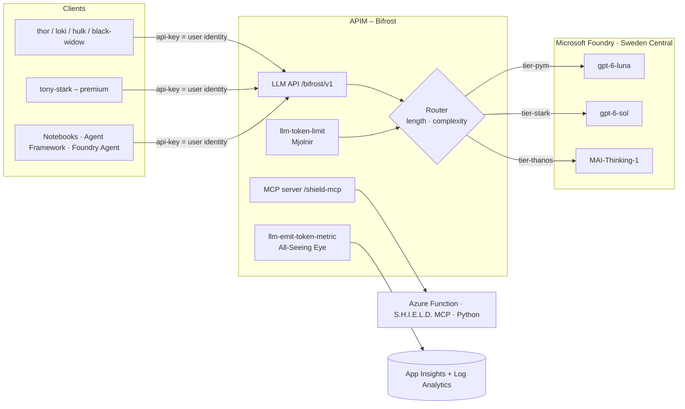

# HEIMDAL – Azure API Management as an LLM & Agent Gateway

> *"I see everything."* – Heimdall, guardian of the Bifrost

A demo showcase of **Azure API Management (APIM) as an AI gateway**: one endpoint for every model and agent tool, with
**per-user token accounting**, a **configurable model router** (prompt length / prompt complexity), and **MCP** exposure.
Models run in **Microsoft Foundry**, infrastructure is **Bicep** in **Sweden Central**, custom code is **Python only**.
No private networking (demo).



## What's inside

| Path | Purpose |
|---|---|
| `infra/` | Bicep: monitoring, Foundry + model deployments, APIM, RBAC, Function app, APIs/products/subscriptions |
| `policies/bifrost-router.xml` | The brain: token limit → model routing → managed-identity call → token metrics → `x-heimdal-*` headers |
| `policies/shield-mcp.xml` | MCP rate limit + function key injection |
| `src/shield-mcp/` | Python Azure Function (MCP extension) with MCU tools |
| `azure.yaml`, `infra/azd/` | `azd up` entry point (subscription-scope wrapper + postdeploy hook `scripts/azd_hook.py`) |
| `scripts/deploy.py`, `teardown.py` | Python wrappers around `az` (alternative to azd); write `.env` for the notebooks |
| `notebooks/` | `00`–`08` demos (below) |

### Naming (MCU theme)
`rg-heimdal-asgard-swc` · `apim-heimdal-bifrost-*` · `fdry-heimdal-asgard-*` / `proj-heimdal-avengers` · `*-allseeing-*` (monitoring) ·
`func-heimdal-shield-mcp-*` · products `avengers-initiative` / `infinity-gauntlet` · users `thor, loki, hulk, black-widow, tony-stark` ·
tiers `pym` / `stark` / `thanos`.

## Deploy

Prereqs: Azure CLI (`az login`), Python 3.11+, permission to create APIM/Foundry/Function resources and role assignments, quota for the models.

```bash
pip install -r requirements.txt
python scripts/deploy.py --check-models                # are the models in swedencentral? (edit infra/main.bicepparam)
python scripts/deploy.py --email you@contoso.com       # ~20-40 min (APIM), writes .env
```

> **Models** (verified against [Models sold directly by Azure](https://learn.microsoft.com/azure/foundry/foundry-models/concepts/models-sold-directly-by-azure)): `gpt-6-luna` and `gpt-6-sol` version `2026-09-22`, `MAI-Thinking-1` (preview, format `Microsoft`) version `2026-06-01`, all `GlobalStandard` in Sweden Central.
> MAI-Thinking-1 is served on `/mai/v1` (not `/openai/v1`) and needs `max_completion_tokens`; the router handles both via the `mai-deployments` named value. Its default quota tier can be 0 TPM – request quota if deployment fails.
> Edit `models` / `tierModels` in `infra/main.bicepparam` (and the defaults in `infra/main.bicep` for azd) to use other deployments.

### Or deploy with `azd` (Azure Developer CLI)

```bash
azd auth login
azd env new heimdal-dev
azd env set AZURE_LOCATION swedencentral
azd env set HEIMDAL_PUBLISHER_EMAIL you@contoso.com
azd up        # provisions infra/azd -> infra/main.bicep, deploys src/shield-mcp, postdeploy hook wires the MCP key + writes .env
```

`azd down --purge` removes everything. `azd` creates the resource group `rg-heimdal-asgard-<env>`.

Teardown (non-azd): `python scripts/teardown.py`.

## Demo flow (notebooks)

| # | Notebook | Shows |
|---|---|---|
| 00 | `00_setup_asgard` | Architecture, deploy, env check |
| 01 | `01_bifrost_basic_call` | OpenAI-compatible gateway call, routing headers |
| 02 | `02_all_seeing_eye_usage` | **Token usage per user** (custom metrics + LLM gateway logs, KQL) |
| 03 | `03_router_prompt_length` | Router by **prompt length**, client overrides |
| 04 | `04_router_complexity` | Router by **prompt complexity** – heuristic vs LLM classifier, live reconfig |
| 05 | `05_mjolnir_token_limits` | Per-user TPM limits, 429 for one user only |
| 06 | `06_shield_mcp_via_bifrost` | **MCP** server (Azure Function) governed by APIM |
| 07 | `07_foundry_agent_via_bifrost` | **Foundry Agent Service** using the gateway as its model |
| 08 | `08_agent_framework_via_bifrost` | **Agent Framework** agent: LLM + MCP tools, both via APIM |

## Router configuration

APIM **named values** (change in portal, `set_router(...)` in notebooks, or Bicep param `router`):

| Named value | Values | Meaning |
|---|---|---|
| `router-mode` | `length` \| `complexity` \| `hybrid` | which signal(s) decide; hybrid = higher tier wins |
| `length-threshold-tokens` | e.g. `500` | est. prompt tokens (chars/4): `<T` pym, `<4T` stark, else thanos |
| `complexity-mode` | `heuristic` \| `llm` | policy scoring vs small-model classifier (falls back to heuristic) |
| `complexity-threshold` | e.g. `3` | score for stark; `2×` for thanos |
| `model-tier-pym/stark/thanos`, `model-classifier` | deployment names | tier → model mapping |
| `tpm-standard`, `tpm-premium` | e.g. `5000` | tokens per minute per user by product |

Clients may also force `model="tier-thanos"` or a concrete deployment name; `model="heimdal-auto"` (or omitted) routes automatically.

## Known notes / caveats
- **Token metrics** require *Custom metrics with dimensions* on the App Insights resource (Usage & estimated costs → Custom metrics → With dimensions; usually default for new workspace-based resources). For streaming, send `stream_options={"include_usage": true}`.
- Logs/metrics lag a few minutes. The LLM logs table (`ApiManagementGatewayLlmLog`) gives exact per-request tokens and model.
- MCP via APIM uses API version `2025-09-01-preview`. The Function MCP extension needs the `mcp_extension` system key; `deploy.py` injects it into the `shield-mcp-key` named value after code publish.
- Foundry connection (notebook 07) and Agent Framework (notebook 08) use preview SDK/APIs – adjust to current docs if signatures changed.
- This is a demo: public endpoints, subscription keys, no VNet. Harden (Entra/JWT auth, private endpoints, Key Vault named values) for real use.
