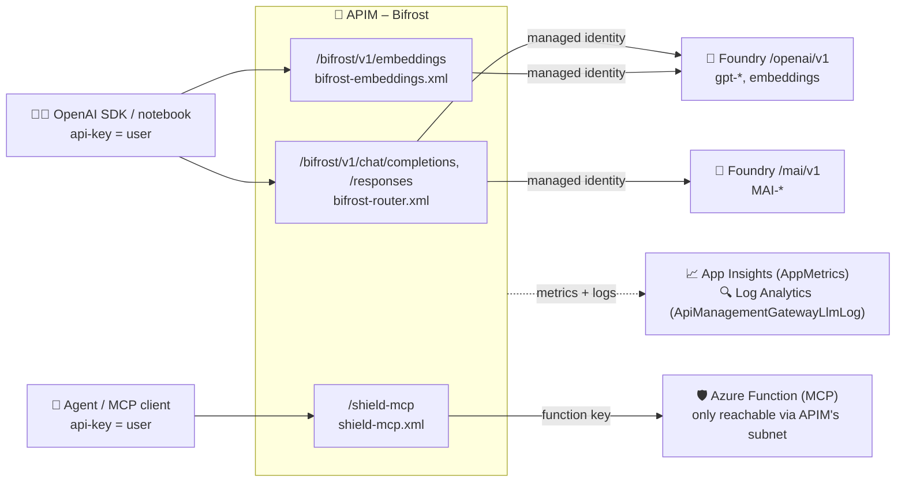

# 🔍 How the APIM integration works

> 💡 **TL;DR:** Azure API Management (APIM, nicknamed **Bifrost**) sits between clients and the models/tools. It **knows who calls** (the subscription), **limits tokens per user**, **picks a model tier** from the prompt, **calls the backend with its own identity**, and **measures everything per user**. All of it is policy plus Bicep, and the router is steered by live named values.
>
> 📋 Looking for the list of what exists? See [apim-definition.md](apim-definition.md). Looking for how a caller becomes a user? See [user.md](user.md).

| | Section | Question it answers |
|---|---|---|
| 🗺️ | 1. Big picture | What talks to what? |
| 👥 | 2. Users and products | Who is calling? |
| 🧠 | 3. The LLM API | How is a call limited, routed and measured? |
| 🔑 | 4. Authentication to Foundry | How does APIM get in? |
| 🛡️ | 5. The MCP API | How are tools exposed safely? |
| 👁️ | 6. Observability | Where do I see usage? |
| 🎛️ | 7. Runtime configuration | How do I change routing live? |
| 🔄 | 8. Request lifecycle | What happens in one call? |
| 🧩 | 9. Extending it | How do I add things? |

---

## 🗺️ 1. Big picture



Three ideas carry the whole design:

1. 🪪 **Identity = APIM subscription.** Every demo user has their own subscription key. APIM knows who calls (`context.Subscription.Name`), so limits and metrics are per user without any custom auth code.
2. 🔒 **Clients never see backend credentials.** The client's key is deleted before forwarding; APIM calls Foundry with its own **system-assigned managed identity** and calls the Function with a **function key** stored as a secret named value. The Function additionally only accepts traffic from APIM's outbound VNet subnet, so the gateway is the only way in.
3. 🎛️ **Behaviour is configuration.** The router reads **named values** (`{{router-mode}}` …), so you can change routing live without redeploying anything.

> 🗂️ Which file does what: see the table in [apim-definition.md](apim-definition.md). The client side lives in `notebooks/heimdal_helpers.py` (`ask()`, `set_router()`, KQL helpers).

---

## 👥 2. Users, products, subscriptions

Defined in `infra/modules/apim-apis.bicep`.

- 🎟️ **Products** group APIs and carry the tier: `avengers-initiative` (standard) and `infinity-gauntlet` (premium). Both contain both APIs (LLM + MCP).
- 👤 **Subscriptions** are created from the `demoUsers` array, one per user, scoped to the user's product (`scope: <apim>/products/<product>`). The subscription *name* is the user name (`thor`, `loki`, …).
- 🔑 Both APIs read the key from the **`api-key` header**, so standard OpenAI clients work: they just put the key in `api-key`. `heimdal_helpers.client()` sends it in both `api-key` and `Authorization`. A key in the URL (`?subscription-key=`) is rejected with 400 by the policies (keys in URLs end up in logs).

`context.Subscription.Name` → user, `context.Product.Id` → tier of limits.

> 🛡️ Details and the OAuth outlook: [user.md](user.md).

---

## 🧠 3. The LLM API (`bifrost-llm`)

- 🛣️ Path `bifrost/v1`, operations `POST /chat/completions`, `POST /responses` (both routed by `bifrost-router.xml`) and `POST /embeddings` → OpenAI-compatible, so `base_url = https://<apim>.azure-api.net/bifrost/v1` is all a client needs.
- 🧬 `/embeddings` has its own operation policy **without `<base />`** (`bifrost-embeddings.xml`): no tiers, `heimdal-auto` → `{{model-embedding}}`, a per-user call rate limit and an `Embedding Tokens` metric (`emit-metric`; the `llm-*` policies don't support the embeddings schema). XML and details: [embeddings-mcp-policies.md](embeddings-mcp-policies.md).
- 🎭 The API's `serviceUrl` is a placeholder; the real backend is chosen **inside the policy** with `set-backend-service`.
- 🔌 Two APIM **backends** exist (`apim.bicep`): `asgard-foundry` (`…openai.azure.com/openai/v1`) and `asgard-foundry-mai` (`…services.ai.azure.com/mai/v1`, for MAI models).

### 🔬 What the router policy does (`policies/bifrost-router.xml`)

> 📜 Every step with its real XML, a short and a detailed explanation: [policies.md](policies.md) (identity, limit, backend, metrics) and [routing.md](routing.md) (length, heuristic, LLM, hybrid).

| Step | What happens | Details |
|---|---|---|
| 🪪 1 | Resolve the caller from the subscription (a key in the URL gets 400) | [policies.md](policies.md#1--caller-identity) |
| 🔨 2 | Per-user token limit, 429 when exceeded | [policies.md](policies.md#2--token-limit-mjolnir) |
| 🧭 3 | Pick a tier: length, heuristic score, optional LLM classifier ([extra cost](routing.md#-does-the-classifier-cost-extra)), or a client override | [routing.md](routing.md) |
| 🔁 4 | Rewrite `model`, pick the backend, authenticate with the managed identity, remove the client's `api-key` | [policies.md](policies.md#4--backend-model-rewrite-and-key-hygiene) |
| 👁️ 5 | Emit per-user token metrics and the `x-heimdal-*` headers | [policies.md](policies.md#5--metrics-and-response-headers) |

`<backend>` just forwards the request. Tier → deployment comes from the `model-tier-pym|stark|thanos` named values.

### 🦾 MAI models

MAI deployments (`{{mai-deployments}}`, comma list) live on a different endpoint (`/mai/v1`) and accept only `max_completion_tokens`. When the routed deployment is in that list, the policy selects the `asgard-foundry-mai` backend and renames `max_tokens` → `max_completion_tokens`. If MAI is disabled the named value is `none` (named values cannot be empty).

### 🦙 Local Ollama models (optional)

Only with `HEIMDAL_ENABLE_OLLAMA=true`. A model on the demo machine, reached through an **ngrok tunnel**. Requirements, setup and troubleshooting: [local-ollama.md](local-ollama.md).

- 🚇 **Setup:** the azd `preprovision` hook ([`ollama_tunnel.py`](../scripts/ollama_tunnel.py)) checks that Ollama serves the model(s) and opens the tunnel. The tunnel uses an ngrok traffic policy: `basic-auth` (a generated secret, stored in the azd env as `HEIMDAL_OLLAMA_AUTH`) and a Host rewrite to `localhost`.
- 🧱 **Bicep:** creates the backend `asgard-ollama` (`<ngrok url>/v1`, Ollama's OpenAI-compatible surface), fills `{{ollama-models}}`, and stores the credentials base64-encoded in the secret named value `{{ollama-basic-auth}}`.
- 🧭 **Routing:** when the *routed* model is in `{{ollama-models}}`, the policy selects `asgard-ollama`. It skips the managed identity and sends `Authorization: Basic {{ollama-basic-auth}}` (overriding the client's header) plus `ngrok-skip-browser-warning`. `x-heimdal-route-reason` gets the prefix `local-ollama;`.
- 🔢 **Token parameter:** Ollama only honours `max_tokens`, and Foundry GPT models only accept `max_completion_tokens`. Clients send `max_completion_tokens`, and the policy renames it to `max_tokens` for Ollama.
- 📈 **Limits and metrics:** work unchanged, because Ollama returns OpenAI-style `usage`. `/embeddings` uses the same check (e.g. `nomic-embed-text`).
- 🐜 **Whole tier local:** the check runs on the routed model, so setting a tier named value (`model-tier-pym` = `gemma4-e4b`) sends that tier to the laptop.
- 🪵 **Did the laptop answer?** `ApiManagementGatewayLogs.BackendId` is `asgard-ollama`. See the workbook section *Local Ollama via ngrok* ([workbook.md](workbook.md)) or `KQL_CALLS_BY_BACKEND` in `heimdal_helpers.py`.

> 💡 The default local model `gemma4:e4b` answers directly. Other small models are often reasoning models (`qwen3.5`, `deepseek-r1`). If the token budget runs out while they think, `content` is empty. Send `reasoning_effort="none"` to switch thinking off, as notebook 09 does.

### 🏷️ Response headers (what the client sees)

`x-heimdal-user`, `x-heimdal-tier`, `x-heimdal-model`, `x-heimdal-route-reason` and `x-heimdal-remaining-tokens`: meaning and XML in [policies.md](policies.md#5--metrics-and-response-headers). `ask()` in `heimdal_helpers.py` reads exactly these.

> ⚠️ **Gotcha – `{{named-value}}` in policy:** `{{name}}` is substituted by APIM **textually**, before the C# expression compiles. That is why numeric ones are wrapped as `int.Parse("{{length-threshold-tokens}}")` and string ones are quoted. A missing named value fails the policy, so every name used in the XML must exist in `apim.bicep`.

---

## 🔑 4. Authentication to Foundry

- 🪪 APIM has a **system-assigned managed identity** (`identity: SystemAssigned` in `apim.bicep`).
- 🎫 `rbac.bicep` grants it, on the Foundry account, **Cognitive Services OpenAI User** (OpenAI models) and – only when `enableMai` is on – **Cognitive Services User** (needed for non-OpenAI formats such as MAI).
- 🧑‍🔧 `rbac.bicep` also grants the demo operator (`deployerPrincipalId`: the azd user / the `az login` identity of `deploy.py`) **Azure AI User** on the Foundry account (notebook 07) and **Log Analytics Reader** (`kql()`).
- 🎟️ The policy requests a token for `https://cognitiveservices.azure.com` with `authentication-managed-identity`.
- ⏱️ `apim-apis` has `dependsOn: [rbac]` so the roles exist before the first call.
- 🤖 The classifier call (`send-request`) authenticates the same way. It is billed like any other call to that deployment: [cost of the classifier](routing.md#-does-the-classifier-cost-extra).
- 🦙 Exception: the optional local Ollama backend has no Entra identity. The policy sends the ngrok basic-auth credentials from the secret named value `ollama-basic-auth` instead.

---

## 🛡️ 5. The MCP API (`shield-mcp`)

- 🔌 A plain HTTP APIM API (POST/GET/DELETE `/mcp`), path `/shield-mcp`, rewritten to the Function's `/runtime/webhooks/mcp` and forwarded unbuffered. (The preview `type: 'mcp'` API ran in managed-tools mode on this instance and returned 500 on `tools/call`.)
- 🧩 The endpoint template maps to the Functions MCP extension: `/runtime/webhooks/mcp` (`endpoints` is an *object* keyed by endpoint name, even though docs show an array).

### 📜 Policy (`shield-mcp.xml`)

Rate limit (30 calls/minute per subscription), function key injection, client credentials removed, response never buffered. The XML line by line: [embeddings-mcp-policies.md](embeddings-mcp-policies.md#5--mcp-rate-limit-and-function-key).

### 🗝️ Where the function key comes from

`shield-mcp-key` gets a placeholder on the very first deployment; `scripts/deploy.py` (or the azd postdeploy hook) replaces it with the real key after the Function code is published, because that key only exists after the deployment. Later deployments get the current key through the secure `mcpKey` parameter (`deploy.py` reads it from the Function, azd from `HEIMDAL_MCP_KEY`, which the hook stores in the azd environment), so a Bicep-only redeploy keeps MCP working.

### 🔒 Network lock-down

APIM (v2 tier) has **outbound VNet integration** into `snet-apim-outbound` (delegated to `Microsoft.Web/serverFarms`, service endpoint `Microsoft.Web`). The Function's access restrictions allow only that subnet (`ipSecurityRestrictionsDefaultAction: Deny`), so calling the Function directly – even with the key – gets 403. The deployment (SCM) endpoint keeps its own open rules for `azd deploy` / zip deploy (Entra ID protected).

---

## 👁️ 6. Observability

The pieces (loggers, diagnostics, workbook) are listed in [apim-definition.md](apim-definition.md). What matters for using them:

| Piece | What you get |
|---|---|
| 📈 `llm-emit-token-metric` (policy) | Metrics `Prompt/Completion/Total Tokens` with dimensions **User, Model, Tier, Agent (from the `x-agent` request header), API ID** → App Insights `AppMetrics` |
| 🔍 Logger `azuremonitor` + `largeLanguageModel.logs` | Per-request token usage and model in `ApiManagementGatewayLlmLog` |

Deliberate choices:

- 🙈 **No request/response body logging.** It would store prompts, and global response-body capture breaks MCP streaming.
- 🔗 The LLM log has no user column; join it to `ApiManagementGatewayLogs` on `CorrelationId` (`ApimSubscriptionId` = user). See `KQL_TOKENS_BY_USER_LLMLOG` in `heimdal_helpers.py`.
- ⏳ Ingestion lags a few minutes → `kql_wait()` retries until rows show up.
- 🌊 For streaming calls clients should send `stream_options={"include_usage": true}` or token counts are missing.

---

## 🎛️ 7. Runtime configuration

The named values (router mode, thresholds, tier models, limits) are created in `apim.bicep` from the `router`, `tierModels` and `tokenLimits` params. The full list with defaults is in [apim-definition.md](apim-definition.md).

Change them without redeploying:

```python
from heimdal_helpers import set_router
set_router(router_mode="hybrid", length_threshold_tokens="200")   # '_' becomes '-'
```

This runs `az apim nv update …`; the policy sees the new value within about a minute (APIM caches named values).

> ⚠️ A redeploy of the Bicep resets them to the values in `infra/config/heimdal.json`.

---

## 🔄 8. Request lifecycle (example)

`ask("Compare Kafka and SQS step by step and explain the trade-offs", user="thor")`:

1. 🧑‍💻 SDK sends `POST /bifrost/v1/chat/completions` with `api-key: <thor key>`, `model: heimdal-auto`.
2. 🪪 APIM validates the subscription → `user = thor`, product `avengers-initiative`.
3. 🔨 `llm-token-limit` checks thor's per-minute budget (standard TPM).
4. 🧭 Router computes length (about 15 tokens → `pym`) and complexity (`compare` + `step by step` + `trade-off` → score 3 → `stark`). Mode `hybrid` takes the higher one: tier `stark`. See [routing.md](routing.md).
5. 🔁 Body `model` is rewritten to the stark deployment; APIM calls `asgard-foundry` with its managed identity.
6. 🏷️ Response returns; outbound adds `x-heimdal-*` headers.
7. 📈 Token metric (user=thor, model, tier) and an LLM log row are emitted; they appear in KQL after a few minutes.

---

## 🧩 9. Extending it

| I want to … | Do this |
|---|---|
| 🧠 add or change a tier model | change `tierModels` (and `models`) in `infra/config/heimdal.json`, or set the `model-tier-*` named value live |
| 👤 add a user | add to `demoUsers` in `infra/config/heimdal.json`; a subscription is created and the deploy script / azd hook writes its key to `.env` as `HEIMDAL_KEY_<NAME>` |
| 🦙 serve a local model | `azd env set HEIMDAL_ENABLE_OLLAMA true` and `HEIMDAL_OLLAMA_MODEL <name>`, then `azd provision` (README → *Local Ollama via ngrok*) |
| 🧮 add a scoring rule | edit `complexityScore` in `bifrost-router.xml` ([how the score works](routing.md#3--routing-by-complexity-heuristic)) and redeploy `apim-apis` |
| 🏭 harden for production | Entra/JWT validation instead of subscription keys, private endpoints (inbound to APIM, Foundry, Function), Key Vault-backed named values, `token-quota` budgets, content safety policies |
