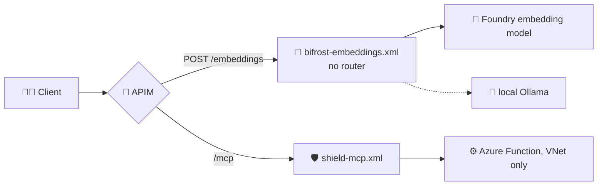

# 🧬 The embeddings and MCP policies

> 💡 **TL;DR:** Two operations do **not** use the router. `POST /embeddings` has its own policy ([bifrost-embeddings.xml](../policies/bifrost-embeddings.xml)): a call rate limit, a fixed embedding model and an `Embedding Tokens` metric. The MCP API has [shield-mcp.xml](../policies/shield-mcp.xml): a call rate limit and the Function key, kept inside APIM. Every section shows the real policy XML, a ⚡ short answer and a 🔬 detailed one.

| 🧩 Policy | 🔨 Limit | 🧠 Model / backend | 📈 Metric |
|---|---|---|---|
| [bifrost-embeddings.xml](../policies/bifrost-embeddings.xml) | `rate-limit-by-key` 120 calls/min | `{{model-embedding}}` (`text-embedding-3-small`) on Foundry, or Ollama | `Embedding Tokens` |
| [shield-mcp.xml](../policies/shield-mcp.xml) | `rate-limit-by-key` 30 calls/min | Azure Function MCP endpoint | none in the policy |

> ℹ️ The XML below is copied from the policy files (shortened where marked). If they ever differ, the policy file wins. Chat and responses are in [policies.md](policies.md) and [routing.md](routing.md).

---

## 🗺️ The big picture



---

## 1. 🧬 Embeddings: no router

> ⚡ **Short:** `/embeddings` has no tiers. `heimdal-auto` just means "the embedding model". The policy has **no `<base />`**, so the API-level router never runs.

**🔬 In detail:** the `llm-*` policies do not support the embeddings schema, so this operation uses classic policies. The header comment of the file:

```xml
<!--
  Deliberately has NO <base />: the API-level router (bifrost-router.xml) is for chat / responses only.
  The llm-* policies don't support the embeddings schema, so this operation uses classic policies:
     rate-limit-by-key        per-user call budget
     model                    "heimdal-auto" | "auto" | missing  ->  {{model-embedding}}, else the deployment as sent
     emit-metric              "Embedding Tokens" per User / Model (namespace heimdal, like the chat token metrics)
-->
```

---

## 2. 🔨 Embeddings: rate limit and model choice

> ⚡ **Short:** 120 calls per minute per user. A missing, `auto` or `heimdal-auto` model becomes the embedding deployment.

```xml
<set-variable name="user" value="@(context.Subscription?.Name ?? &quot;anonymous&quot;)" />
<rate-limit-by-key calls="120" renewal-period="60"
    counter-key="@(&quot;emb-&quot; + (context.Subscription?.Id ?? context.Request.IpAddress))" />

<set-variable name="body" value="@(context.Request.Body.As&lt;JObject&gt;(preserveContent: true))" />
<set-variable name="routedModel" value="@{
    var m = (string)((JObject)context.Variables[&quot;body&quot;])[&quot;model&quot;] ?? &quot;&quot;;
    return (m.Length == 0 || m == &quot;heimdal-auto&quot; || m == &quot;auto&quot;) ? &quot;{{model-embedding}}&quot; : m;
}" />
<set-body>@{
    var b = (JObject)context.Variables["body"];
    b["model"] = (string)context.Variables["routedModel"];
    return b.ToString();
}</set-body>
```

**🔬 In detail:**
- The limit counts **calls**, not tokens. The counter key has the prefix `emb-`, so it is separate from other counters of the same user.
- Any other model name is used as sent.
- The same `key_in_url` check as in the other policies comes first (not shown).

---

## 3. 🔀 Embeddings: backend

> ⚡ **Short:** Foundry by default. If the model is listed in `ollama-models`, the call goes to the local Ollama.

```xml
<choose>
  <when condition="@((&quot;,{{ollama-models}},&quot;).ToLowerInvariant().Contains(&quot;,&quot; + ((string)context.Variables[&quot;routedModel&quot;]).ToLowerInvariant() + &quot;,&quot;))">
    <set-backend-service backend-id="asgard-ollama" />
    <set-header name="Authorization" exists-action="override">
      <value>Basic {{ollama-basic-auth}}</value>
    </set-header>
    <set-header name="ngrok-skip-browser-warning" exists-action="override">
      <value>1</value>
    </set-header>
  </when>
  <otherwise>
    <set-backend-service backend-id="asgard-foundry" />
    <authentication-managed-identity resource="https://cognitiveservices.azure.com" />
  </otherwise>
</choose>
<set-header name="api-key" exists-action="delete" />
<set-query-parameter name="api-version" exists-action="delete" />
```

**🔬 In detail:** same pattern as the chat router: managed identity for Foundry, basic auth for the ngrok tunnel, and the client's `api-key` is never forwarded. See [policies.md](policies.md) section 4 and [local-ollama.md](local-ollama.md).

---

## 4. 📈 Embeddings: metric and headers

> ⚡ **Short:** Token usage is read from the response and emitted per user and model. Headers show who and which model.

```xml
<outbound>
  <choose>
    <when condition="@(context.Response.StatusCode == 200)">
      <emit-metric name="Embedding Tokens" namespace="heimdal"
          value="@{
              var usage = context.Response.Body.As&lt;JObject&gt;(preserveContent: true)[&quot;usage&quot;];
              return usage == null ? 0 : (double)usage[&quot;total_tokens&quot;];
          }">
        <dimension name="User" value="@((string)context.Variables[&quot;user&quot;])" />
        <dimension name="Model" value="@((string)context.Variables[&quot;routedModel&quot;])" />
        <dimension name="Agent" value="@(context.Request.Headers.GetValueOrDefault(&quot;x-agent&quot;, &quot;none&quot;))" />
      </emit-metric>
    </when>
  </choose>
  <set-header name="x-heimdal-user" exists-action="override">
    <value>@((string)context.Variables["user"])</value>
  </set-header>
  <set-header name="x-heimdal-model" exists-action="override">
    <value>@((string)context.Variables["routedModel"])</value>
  </set-header>
</outbound>
```

**🔬 In detail:**
- Only `200` responses are counted. The value is `usage.total_tokens`, or 0 if the response has no `usage`.
- No `x-heimdal-tier` or `x-heimdal-route-reason`, because nothing was routed.

---

## 5. 🛡️ MCP: rate limit and function key

> ⚡ **Short:** The MCP tools are governed like the models: a per-user rate limit, and the Function key stays inside APIM.

```xml
<policies>
  <inbound>
    <base />
    <!-- keys in URLs end up in logs: header only (same 400 key_in_url check as the router) -->
    <rate-limit-by-key calls="30" renewal-period="60"
        counter-key="@(context.Subscription?.Id ?? context.Request.IpAddress)" />
    <!-- Functions MCP extension requires the mcp_extension system key -->
    <set-header name="x-functions-key" exists-action="override">
      <value>{{shield-mcp-key}}</value>
    </set-header>
    <rewrite-uri template="/runtime/webhooks/mcp" copy-unmatched-params="false" />
    <set-header name="api-key" exists-action="delete" />
    <set-header name="Ocp-Apim-Subscription-Key" exists-action="delete" />
  </inbound>
  <backend>
    <forward-request buffer-response="false" />
  </backend>
  ...
</policies>
```

**🔬 In detail:**

| Line | Why |
|---|---|
| `rate-limit-by-key calls="30"` | 30 MCP calls per minute per subscription |
| `x-functions-key` = `{{shield-mcp-key}}` | the Functions MCP extension needs its `mcp_extension` system key. The postdeploy hook fills the named value |
| `rewrite-uri` to `/runtime/webhooks/mcp` | the Function's MCP endpoint |
| delete `api-key`, `Ocp-Apim-Subscription-Key` | the client's key never reaches the Function |
| `buffer-response="false"` | keeps the MCP stream unbuffered. That is why the policy never touches `context.Response.Body` |

- The Function accepts traffic only from APIM's outbound VNet subnet, so this API is the only way in.
- Notebook: `06_shield_mcp_via_bifrost`. Setup details: [apim-integration.md](apim-integration.md) section 5.
