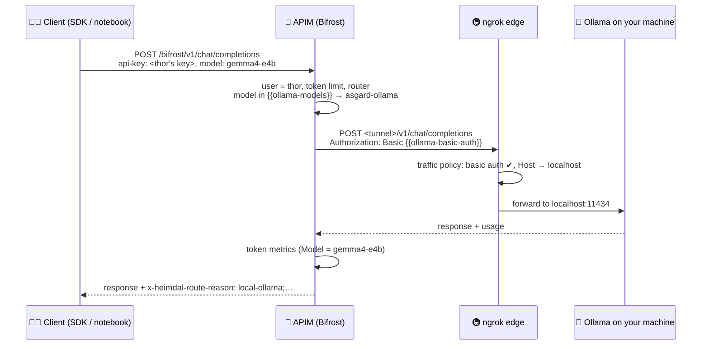
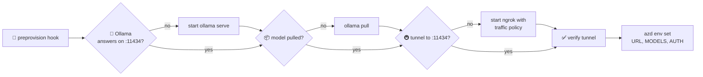
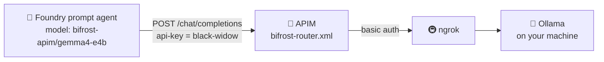

# 🦙 How a local Ollama model joins the gateway

> 💡 **TL;DR:** A model that runs **on your own machine** in [Ollama](https://ollama.com) can sit behind the same APIM gateway as the Foundry models. An **ngrok tunnel** with basic auth makes it reachable for APIM. One `azd up` with `HEIMDAL_ENABLE_OLLAMA=true` checks and starts everything and wires the tunnel URL into APIM. Clients only change the `model` name. Keys, token limits, metrics and `x-heimdal-*` headers stay the same.

> 🧪 **Optional and demo-grade.** Off by default. It is for experimenting: one machine, one public tunnel, no failover. See [what it does not do](#-what-it-does-not-do).

---

## ✅ Requirements – check these first

You need **all** of these on the machine that runs `azd up`. That machine is also the one that serves the model.

| | Requirement | Why | ✔️ Check |
|---|---|---|---|
| 🦙 | **Ollama** installed ([download](https://ollama.com/download)) | Serves the model on `localhost:11434` with an OpenAI-compatible API (`/v1`) | `ollama --version` |
| 🚇 | **ngrok** installed ([download](https://ngrok.com/download)) | Makes `localhost:11434` reachable from Azure | `ngrok version` |
| 🔑 | **ngrok authtoken** configured (a free account is enough) | ngrok refuses to start a tunnel without it | `ngrok config add-authtoken <token>` once ([get the token](https://dashboard.ngrok.com/get-started/your-authtoken)) |
| ☝️ | **No other ngrok agent online** | The free plan allows one agent session at a time | Close other `ngrok` windows |
| 💾 | **Disk and RAM for the model** | `ollama pull` downloads it on first use, and it runs locally | the default `gemma4:e4b` is a 6.6 GB download; the first call after a while takes ~15 s to load it |
| 🐍 | **Python 3.11+** | The hook [scripts/ollama_tunnel.py](../scripts/ollama_tunnel.py) is plain Python (standard library only) | `python --version` |
| ☁️ | **The normal gateway deployment** | Ollama is an extra backend of the existing APIM | `azd`, `az`, see [README → Deploy](../README.md#-deploy-with-azd) |
| 📶 | **Machine stays on and online** | APIM calls your machine for every request to the local model | Don't let it sleep during a demo |

> ⚠️ The free ngrok plan has a monthly data-transfer cap and assigns its own domain. A **fixed domain** is optional (`HEIMDAL_OLLAMA_NGROK_DOMAIN`). Without it, the URL can change when ngrok restarts (see [section 8](#8--day-2-url-changes-switching-models-stopping)).

---

## 🗺️ The big picture

One call from `thor` to the local model:



Sections 1–3 cover the setup that `azd up` does. Sections 4–6 cover what happens on every call. Section 7 puts a Foundry agent on the local model.

---

## 1. 🚀 Turn it on

```bash
azd env set HEIMDAL_ENABLE_OLLAMA true
azd env set HEIMDAL_OLLAMA_MODEL gemma4:e4b                   # the default; any model from ollama.com/library, comma-separated
# azd env set HEIMDAL_OLLAMA_NGROK_DOMAIN you.ngrok-free.app  # optional fixed domain
azd up                                                        # or azd provision if the rest is already deployed
```

| 🔑 Variable | Default | Meaning |
|---|---|---|
| `HEIMDAL_ENABLE_OLLAMA` | `false` | `true` turns the feature on. Anything else: the hook does nothing and APIM gets no Ollama backend |
| `HEIMDAL_OLLAMA_MODEL` | `gemma4:e4b` | Model(s) to serve, comma-separated, as Ollama names them. Clients use the gateway name, e.g. `gemma4-e4b` (section 2, step 4) |
| `HEIMDAL_OLLAMA_NGROK_DOMAIN` | empty | Fixed ngrok domain. Empty = the URL ngrok assigns |

Which model? Tested on a laptop with the Asgardians prompt of notebook 09:

| 🦙 Model | Size | Reasoning? | Result |
|---|---|---|---|
| ✅ `gemma4:e4b` (default) | 6.6 GB | no | Answers directly, mostly correct, ~6 s warm. Good for the Foundry agent too |
| ⚠️ `qwen3.5:0.8b` | 1.3 GB | yes | Empty answers unless `reasoning_effort="none"`, invents facts |
| 💡 `llama3.2` | ~2 GB | no | Smaller alternative (not tested here) |

Without azd: `HEIMDAL_ENABLE_OLLAMA=true python scripts/deploy.py --email …` runs the same hook before the Bicep deployment ([deploy.py](../scripts/deploy.py) → `ollama_tunnel.ensure()`).

---

## 2. 🔧 What the preprovision hook does

[azure.yaml](../azure.yaml) runs `python scripts/ollama_tunnel.py` as the **`preprovision`** hook, so it runs before every `azd provision` and `azd up`. Each step either succeeds or stops azd with a clear message.



| # | Step | Details |
|---|---|---|
| 1 | 🦙 **Ollama installed?** | `ollama` on `PATH`, else stop with install hints (winget / brew / curl) |
| 2 | ▶️ **Ollama serving?** | `GET http://localhost:11434/api/tags`. If nothing answers: start `ollama serve` in the background and wait up to 30 s |
| 3 | 📦 **Model available?** | Every model of `HEIMDAL_OLLAMA_MODEL` must be in `/api/tags` (`llama3.2` matches `llama3.2:latest`). Missing ones are pulled with `ollama pull` |
| 4 | 🏷️ **Gateway name** | Foundry model ids only allow letters, digits, `-`, `_` and `.`. A tagged model gets an alias without `:` via `ollama cp` (`gemma4:e4b` → `gemma4-e4b`), same weights, no extra download. `llama3.2` / `llama3.2:latest` stay `llama3.2`. **Clients use the gateway name** |
| 5 | 🔑 **Tunnel secret** | Reuse `HEIMDAL_OLLAMA_AUTH` from the azd env, else generate `heimdal:<random 32 chars>` once |
| 6 | 🚇 **ngrok installed?** | `ngrok` on `PATH` and `ngrok config check` passes |
| 7 | 🔍 **Tunnel already running?** | Asks ngrok's local API (`127.0.0.1:4040`–`4045`) for a tunnel whose target ends in `:11434` |
| 8 | 🆕 **Start a tunnel** | Only if none is running: writes the traffic policy (section 3) and starts `ngrok http 11434 --traffic-policy-file … [--url <domain>]` in the background, waits up to 30 s |
| 9 | ✅ **Verify** | `GET <tunnel>/v1/models` **without** credentials must return **401**. **With** credentials it must return 200 and list every requested model |
| 10 | 💾 **Hand over to Bicep** | `azd env set HEIMDAL_OLLAMA_URL / HEIMDAL_OLLAMA_MODELS` (the gateway names) `/ HEIMDAL_OLLAMA_AUTH`. [main.parameters.json](../infra/azd/main.parameters.json) passes them to Bicep |

> 🔁 **Idempotent:** a second run reuses the running Ollama and tunnel and only verifies them. The hook **never stops processes it did not start**. If a tunnel to `:11434` is running *without* the Heimdal policy, step 9 fails and asks you to stop it.

Files the hook keeps (git-ignored), in `.azure/<env>/` (or `.ollama-tunnel/` without azd):

| 📄 File | Content |
|---|---|
| `ollama-tunnel.json` | PIDs of the processes the hook started, the tunnel secret |
| `ngrok-ollama.yml` | The generated ngrok traffic policy (contains the secret) |
| `ngrok.log`, `ollama.log` | Output of the background processes. The hook prints their tail when a start fails |

---

## 3. 🔒 The tunnel and its protection

The ngrok URL is **public**. Two actions in the traffic policy run on every request before it reaches your machine:

```yaml
on_http_request:
  - actions:
      - type: basic-auth          # 401 unless Authorization: Basic heimdal:<secret>
        config:
          credentials: ["heimdal:<secret>"]
          enforce: true
      - type: add-headers         # Ollama only accepts local Host headers
        config:
          headers:
            host: localhost
```

| 🛡️ Who calls the tunnel | Result |
|---|---|
| 🌍 Anyone without credentials | **401** from ngrok, nothing reaches Ollama |
| 👤 A user with their APIM key, directly | **401**: the APIM key is not the tunnel secret |
| 🌈 APIM | ✅ sends `Authorization: Basic {{ollama-basic-auth}}` |

> 🔑 The secret lives in three places: the azd env (`.azure/<env>/.env`), the policy file next to it, and the secret APIM named value `ollama-basic-auth` (base64). Don't commit `.azure/`, which is already in `.gitignore`.

---

## 4. 🧱 What Bicep creates

| Resource | Name | When | Value |
|---|---|---|---|
| 🔌 Backend | `asgard-ollama` | only if `enableOllama` **and** URL **and** models are set | `<tunnel URL>/v1` (Ollama's OpenAI-compatible API) |
| 🎛️ Named value | `ollama-models` | always | the model list, or `none` when off |
| 🔒 Named value (secret) | `ollama-basic-auth` | always | base64 of `heimdal:<secret>`, or `not-configured` when off |
| 🤖 Foundry connection models | `bifrost-apim` | always | `heimdal-auto`, plus the Ollama models when on (see [section 7](#7--foundry-agents-on-the-local-model)) |

Both named values exist even when the feature is off: the policy references them, and a missing named value would break the policy. See [apim.bicep](../infra/modules/apim.bicep) and the condition `ollamaOn` in [main.bicep](../infra/main.bicep).

The output `HEIMDAL_OLLAMA_ENABLED` tells you whether the backend was really wired. The postdeploy hook then writes `HEIMDAL_OLLAMA_MODELS` to `.env` for the notebooks.

---

## 5. 🧭 What the policy does on each call

All of this is in [bifrost-router.xml](../policies/bifrost-router.xml), step 4. Steps 1–3 of the policy (user, token limit, router) run as for every call.

| # | Step | Detail |
|---|---|---|
| 1 | 🎯 **Is it an Ollama model?** | `isOllama` = the **routed** model is in `,{{ollama-models}},` (case-insensitive). The routed model is the client's `model`, or what a tier maps to |
| 2 | 🔢 **Fix the token parameter** | Ollama only honours `max_tokens`, Foundry GPT models only accept `max_completion_tokens`. If the client sent `max_completion_tokens`, it is renamed to `max_tokens` for Ollama |
| 3 | 🔌 **Pick the backend** | `asgard-ollama` instead of `asgard-foundry` / `asgard-foundry-mai` |
| 4 | 🔒 **Swap the credentials** | No managed identity. `Authorization: Basic {{ollama-basic-auth}}` overrides the client's `Authorization` header (SDKs send the APIM key there as `Bearer`), plus `ngrok-skip-browser-warning: 1`. `api-key` is deleted as for every backend |
| 5 | 🏷️ **Label the route** | `x-heimdal-route-reason` gets the prefix `local-ollama;`, e.g. `local-ollama;client-selected-deployment` |

> 🐜 **A whole tier can go local.** Because the check runs on the *routed* model, setting the named value `model-tier-pym` to `gemma4-e4b` sends every small/simple prompt to your machine, with no client change. Notebook 09 shows this.

`POST /embeddings` ([bifrost-embeddings.xml](../policies/bifrost-embeddings.xml)) has the same backend and credential switch, e.g. for `nomic-embed-text`. `POST /responses` goes through the same router; whether it works depends on your Ollama version's `/v1/responses` support.

---

## 6. 📈 Limits, metrics and logs

| | What | Works for Ollama? |
|---|---|---|
| ⚡ | `llm-token-limit` per user | ✅ same budget as Foundry calls |
| 📈 | `llm-emit-token-metric` (User, Model, Tier, Agent) | ✅ Ollama returns OpenAI-style `usage`. `Model` = the Ollama model name |
| 🪵 | `ApiManagementGatewayLogs` | ✅ `BackendId = asgard-ollama`, `BackendTime`, `BackendResponseCode` |
| 🔍 | `ApiManagementGatewayLlmLog` (exact tokens) | 🧪 not verified for the Ollama backend yet |

Where to look:

- 📊 Workbook *Heimdal - LLM token usage* → section **Local Ollama via ngrok**: local calls, failures, latency, local vs Foundry. Details in [workbook.md](workbook.md#8--local-ollama-via-ngrok-optional).
- 🐍 `KQL_CALLS_BY_BACKEND` in [heimdal_helpers.py](../notebooks/heimdal_helpers.py): the same split as a DataFrame.
- 🌊 For streaming, send `stream_options={"include_usage": True}` so the last chunk carries the usage the metric needs.

---

## 7. 🤖 Foundry agents on the local model

Foundry Agent Service can use models **behind your own gateway** ("bring your own model"). The deployment already registers the gateway in the Foundry project as the `ApiManagement` connection **`bifrost-apim`** ([foundry-connection.bicep](../infra/modules/foundry-connection.bicep)). Notebook 07 uses it with `heimdal-auto`.

Foundry agents only see the models **listed in the connection metadata** (static discovery). With the local lane on, [main.bicep](../infra/main.bicep) adds the Ollama models to that list. A prompt agent can then use `bifrost-apim/<local model>`:



| | What | Detail |
|---|---|---|
| 👤 | **Who is calling** | The connection stores the key of `foundryAgentUser` (`black-widow`, [heimdal.json](../infra/config/heimdal.json)). All agent calls are attributed to that user: token limit, metrics, logs |
| 🔁 | **Same policy** | Foundry calls the gateway's `/chat/completions`. The router sees an Ollama model and sends it to `asgard-ollama`, exactly as for a direct client |
| 🧠 | **Managed in Foundry, answered locally** | The agent definition lives in the Foundry project. Every model call is answered by your machine |
| 🏷️ | **Model names** | Foundry rejects ids with `:` (`Invalid model_id 'qwen3.5:0.8b'`). That is why the hook serves tagged models under a gateway name without `:` (step 4 in section 2): the agent uses `bifrost-apim/gemma4-e4b` |
| ⚙️ | **Needs one `azd up`** | The connection gets the new model list with the Bicep, and `.env` (read by the notebooks) is rewritten by the postdeploy hook. After enabling Ollama or changing `HEIMDAL_OLLAMA_MODEL`, run `azd up` |

In Python ([heimdal_helpers.py](../notebooks/heimdal_helpers.py)):

```python
project, conn = foundry_project()
print(foundry_agent_ask(project, question="Who guards the Bifrost?", agent_name="heimdall-local",
                        instructions="You are Heimdall. Be concise.", model="gemma4-e4b"))
```

> 🧪 **Preview APIs.** This uses `azure-ai-projects` 2.x, like notebook 07. Small local models may handle the agent's prompts poorly. Reasoning models make the agent slower, because the agent cannot switch thinking off.

---

## 8. 🔁 Day 2: URL changes, switching models, stopping

| 🎯 Situation | Do this |
|---|---|
| ngrok restarted and got a **new URL** | `azd provision`. The hook finds the new tunnel and Bicep updates the backend |
| Use a **different model** | `azd env set HEIMDAL_OLLAMA_MODEL <name>`, then `azd up` (the hook pulls it and names it, Bicep updates APIM and the Foundry connection, the postdeploy hook updates `.env`) |
| **Stop** Ollama and ngrok | `python scripts/ollama_tunnel.py --stop` stops only the processes the hook started |
| **Turn the feature off** | `azd env set HEIMDAL_ENABLE_OLLAMA false`, then `azd provision`. `ollama-models` becomes `none`, so no call goes to the tunnel anymore |

> ⚠️ Turning it off does not delete the `asgard-ollama` backend object, it just stops being used. `azd down --purge` removes everything.

---

## 9. 🧪 Try it

Notebook [`09_local_ollama_via_bifrost`](../notebooks/09_local_ollama_via_bifrost.ipynb) walks through it: a status check of Ollama, the model and the tunnel; a first call; local vs Foundry side by side; streaming; the locked tunnel; a tier routed to the laptop; a Foundry agent on the local model; metrics and logs. Run it on the machine that hosts Ollama.

The shortest version:

```python
from heimdal_helpers import ask
r = ask("Who guards the Bifrost?", user="thor", model="gemma4-e4b",
        max_completion_tokens=400, reasoning_effort="none")
print(r["reason"], r["answer"])   # local-ollama;client-selected-deployment …
```

> 🧠 **Empty answer?** The default `gemma4:e4b` answers directly. Many other small models are **reasoning models** (`qwen3.5`, `deepseek-r1`). They think first, and a tight token budget runs out before the answer: `content` is empty and the thinking sits in the extra `reasoning` field. `reasoning_effort="none"` switches thinking off on Ollama's OpenAI API. Ollama's native `"think": false` is ignored there.

---

## 🩺 Troubleshooting

| 😖 Symptom | 🔎 Cause | 🔧 Fix |
|---|---|---|
| Hook: `Ollama is not installed` / `ngrok is not installed` | Not on `PATH` | Install it, open a new terminal |
| Hook: `ngrok has no authtoken` (`ERR_NGROK_4018`) | Token missing | `ngrok config add-authtoken <token>` |
| Hook: `ngrok did not open a tunnel within 30 s` | Another ngrok agent is online (free plan), or a bad domain | Stop other ngrok sessions, check `HEIMDAL_OLLAMA_NGROK_DOMAIN`, read `ngrok.log` |
| Hook: `answered … without credentials (expected 401)` | A tunnel to `:11434` runs without the Heimdal policy | Stop that ngrok process, run the hook again |
| Hook: `rejected the Heimdal credentials` | Tunnel started with another secret | Stop that ngrok process, run the hook again |
| `HEIMDAL_OLLAMA_ENABLED` is `false` after the first `azd up` | The backend was not wired in that run | Run `azd provision` once more |
| Calls fail with **502 / 504**, `BackendResponseCode` 0 | Machine asleep, Ollama or ngrok stopped, or a new tunnel URL | Run `azd provision` (restarts and re-wires) |
| Answer is empty, `completion_tokens` = your limit | Reasoning model used the whole budget | `reasoning_effort="none"` or a bigger `max_completion_tokens` |
| Local model ignores the token limit | Client sent `max_completion_tokens` against an old policy | `azd provision` to deploy the current policy |
| Notebook 09: `… is not in the connection yet` | The Foundry connection still lists only `heimdal-auto`, or `.env` has an old model name | `azd up`, then restart the notebook kernel |
| Foundry agent: `model not found` | Model not in the connection | `azd up` |
| Foundry agent: `Invalid model_id 'qwen3.5:0.8b'` | The name still has `:` (deployed before the hook created gateway names) | `azd up`, then use the gateway name, e.g. `qwen3.5-0.8b` or `gemma4-e4b` |
| Foundry call: `Unsupported parameter: 'max_tokens'` | Foundry GPT models want `max_completion_tokens` | Send `max_completion_tokens` for every model |

---

## 🚫 What it does not do

These are **not implemented**. It is a demo feature.

| ❌ Not there | Consequence |
|---|---|
| Failover to Foundry | If the tunnel is down, calls for the local model fail (5xx). There is no backend pool or circuit breaker |
| Automatic URL refresh | A new ngrok URL needs `azd provision` |
| Several machines / load balancing | One tunnel, one machine |
| Private networking | The tunnel is public, protected only by basic auth |
| Secret rotation | The tunnel secret is generated once. To rotate it: stop the tunnel (`--stop`), remove the `HEIMDAL_OLLAMA_AUTH` line from `.azure/<env>/.env` and delete `.azure/<env>/ollama-tunnel.json`, then `azd provision` |
| Model quality | Small local models answer fast but can be wrong. Use a larger model for meaningful comparisons |
