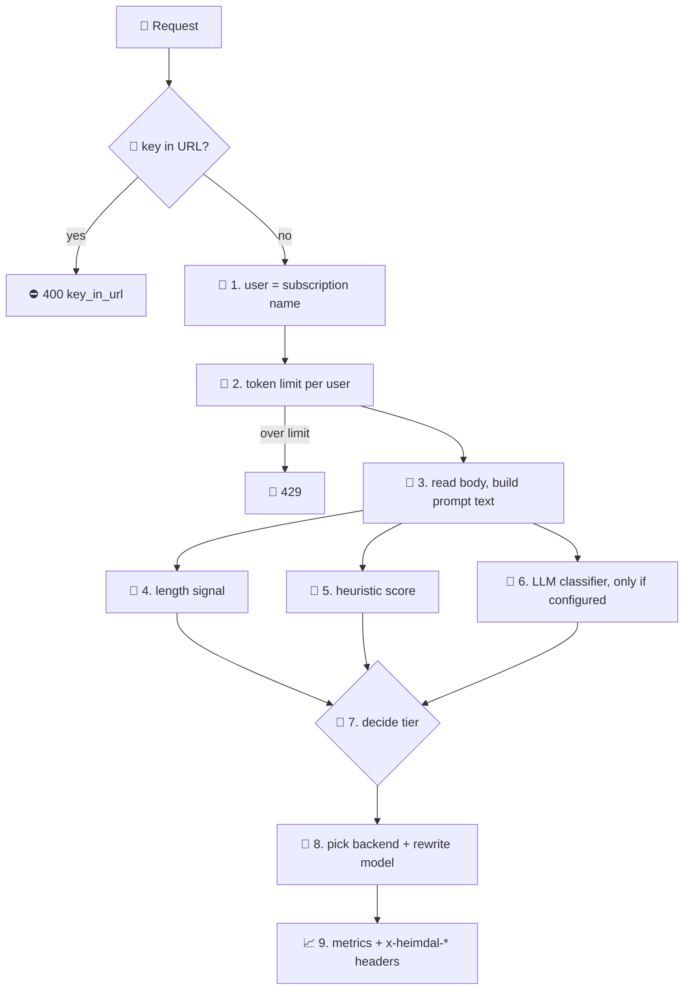
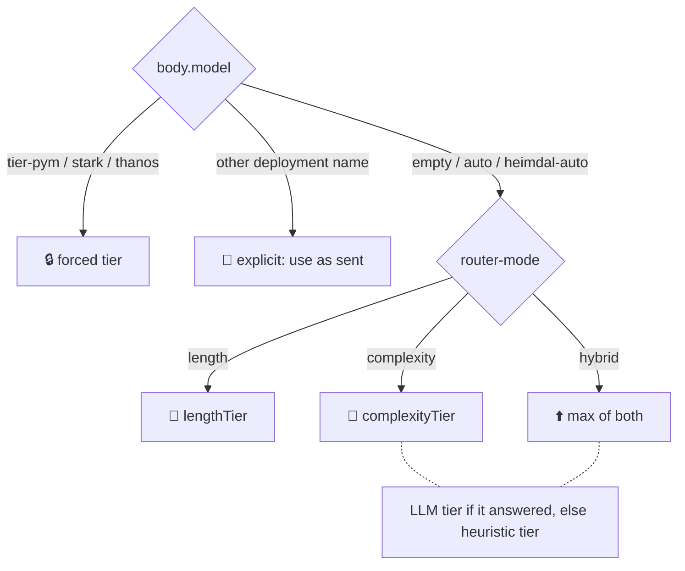

# 📜 What the APIM policies do (and how routing decides)

> 💡 **TL;DR:** Three XML policies run the gateway. [bifrost-router.xml](../policies/bifrost-router.xml) is the brain for chat and responses: it identifies the caller, limits tokens, **picks a model tier** (`pym` / `stark` / `thanos`) from the prompt, calls the backend and records everything. The tier comes from **length** (prompt size), **complexity** (a keyword score, or a small LLM as judge), or **hybrid** (the higher of both). Each section below has a ⚡ short answer and a 🔬 detailed one.

| 🧩 Policy | 🎯 Applies to | 🧠 What it does |
|---|---|---|
| [bifrost-router.xml](../policies/bifrost-router.xml) | `POST /chat/completions`, `POST /responses` | user, token limit, **router**, backend, metrics, headers |
| [bifrost-embeddings.xml](../policies/bifrost-embeddings.xml) | `POST /embeddings` | rate limit, embedding model, `Embedding Tokens` metric. **No router** |
| [shield-mcp.xml](../policies/shield-mcp.xml) | `/mcp` of the `shield-mcp` API | rate limit, function key injection |

| 🥉🥈🥇 Tier | 🧠 Default model ([heimdal.json](../infra/config/heimdal.json)) | 📏 Length rule (500 tokens) | 🧮 Score rule (threshold 3) |
|---|---|---|---|
| 🐜 `pym` | `gpt-6-luna` | below 500 | below 3 |
| 🦾 `stark` | `gpt-5-6-terra` | 500 up to 1,999 | 3 up to 5 |
| 🌌 `thanos` | `gpt-6-1-sol` (or `mai-thinking-1` if MAI is enabled) | 2,000 and up | 6 and up |

---

## 🗺️ The big picture

The order of steps in `bifrost-router.xml`. Sections 1–9 follow it.



---

## 1. 👤 Caller identity

> ⚡ **Short:** The user is the APIM subscription behind the `api-key` header. Its name (`thor`, `tony-stark`) tags every metric and response.

**🔬 In detail:**
- The policy first rejects `?subscription-key=` in the URL with `400 key_in_url`. Keys in URLs end up in logs.
- It then stores `context.Subscription.Name` as the `user` variable (`anonymous` is only a safety net).
- The product decides the tier of the *limit* (section 2), not the model tier. Do not mix them up.
- Full story, including why subscriptions and not OAuth: [user.md](user.md).

---

## 2. 🔨 Token limit (Mjolnir)

> ⚡ **Short:** Each user gets a tokens-per-minute budget. Go over it and you get `429`, while other users keep working.

**🔬 In detail:**

| Product | Named value | Default |
|---|---|---|
| `avengers-initiative` (standard) | `tpm-standard` | 5,000 TPM |
| `infinity-gauntlet` (premium) | `tpm-premium` | 100,000 TPM |

- Policy: `llm-token-limit` with `counter-key` = `context.Subscription.Id` and `estimate-prompt-tokens="true"`. APIM counts the prompt *before* the call, so a huge prompt is stopped without paying for it.
- The limit runs **before routing**. It counts tokens per user, whatever tier or model the router picks later.
- `x-heimdal-remaining-tokens` shows what is left in the minute.
- There are two `llm-token-limit` blocks in a `choose`. The named value is substituted when the policy loads, so each block needs its own static value.
- Notebook: `05_mjolnir_token_limits`.

---

## 3. 📖 Reading the request

> ⚡ **Short:** The policy reads the body once and glues all prompt text into one string. Every routing signal works on that string.

**🔬 In detail:**
- `requestedModel` is `body.model`, or empty. `isAuto` is true when it is empty, `heimdal-auto` or `auto`. SDKs force a `model`, so `heimdal-auto` is the "decide for me" value.
- `promptText` collects text from both API shapes: `messages[].content` (chat) and `instructions` + `input` (Responses). Content parts of type text are included.
- `messageCount` is the number of messages or input items.
- ⚠️ The **whole conversation** counts: system prompt, history and the new question. A long chat drifts towards a higher tier even if the last question is simple. Images, tool definitions and tool results are not in `promptText`.

---

## 4. 📏 Routing by length

> ⚡ **Short:** Longer prompt, bigger model. The policy estimates tokens as characters divided by 4 and compares with `length-threshold-tokens`.

**🔬 In detail:**

```
promptTokens = promptText.Length / 4
lengthTier   = tokens < T ? pym : tokens < 4*T ? stark : thanos      (T = length-threshold-tokens, default 500)
```

| Prompt size | Estimated tokens | Tier |
|---|---|---|
| a short question (120 chars) | 30 | 🐜 `pym` |
| a pasted email (3,000 chars) | 750 | 🦾 `stark` |
| a pasted document (10,000 chars) | 2,500 | 🌌 `thanos` |

- 💡 Why length: cheap to compute, predictable, no extra call. Big inputs need big context windows and often more careful models.
- ⚠️ It is a rough guess. `chars / 4` fits English; other languages and code tokenize differently. Length says nothing about difficulty: a long, easy text still goes up.
- Set it with `router-mode=length`. Notebook: `03_router_prompt_length`.

---

## 5. 🧮 Routing by complexity: heuristic

> ⚡ **Short:** The policy scores the prompt with simple rules (code, "analyze", "compare", many questions, maths). A higher score means a bigger model. It is fast and free, but only a keyword guess.

**🔬 In detail:** The text is lower-cased and scored. The policy computes this score on every call, so it is always available as a fallback.

| 🔎 Signal | ➕ Points | Matches (substring) |
|---|---|---|
| 💻 Code or query | +2 | `` ``` ``, `def `, `class `, `select `, `function ` |
| 🧠 Reasoning words | +1 each, **max 3** | `step by step`, `explain why`, `analyze`, `analyse`, `compare`, `trade-off`, `tradeoff`, `prove`, `derive`, `optimize`, `architecture`, `evaluate`, `design a`, `strategy`, `root cause`, `pros and cons` |
| ❓ Several questions | +1 for 2–3 `?`, +2 for 4 or more | count of `?` |
| ➗ Maths | +1 | `integral`, `theorem`, `equation`, `probability` |
| 💬 Long conversation | +1 | more than 6 messages |

The best possible score is 9.

```
heuristicTier = score < C ? pym : score < 2*C ? stark : thanos      (C = complexity-threshold, default 3)
```

| Prompt | Score | Tier |
|---|---|---|
| "What is the capital of France?" | 0 | 🐜 `pym` |
| "Compare REST and gRPC step by step and explain the trade-offs." | 3 (`compare`, `step by step`, `trade-off`) | 🦾 `stark` |
| A code block, "analyze", "architecture", "evaluate" and four questions | 7 (2 + 3 + 2) | 🌌 `thanos` |

- ⚠️ **False positives:** matching is plain substring. "first class", "function of the board" or "select a date" add code points. The score is a signal, not a judgement.
- Set it with `router-mode=complexity` and `complexity-mode=heuristic`. Notebook: `04_router_complexity`.

---

## 6. 🤖 Routing by complexity: LLM classifier

> ⚡ **Short:** A small, cheap model reads the prompt and answers one word: `simple`, `medium` or `complex`. That is smarter than keywords, but it costs one extra call and some latency.

**🔬 In detail:**

| Step | What happens |
|---|---|
| 1️⃣ **When it runs** | Only if `router-mode` is not `length`, `complexity-mode` is `llm` **and** the request is auto (`isAuto`). Forced tiers and named deployments skip it |
| 2️⃣ **The call** | `send-request` to `{{foundry-openai-base}}/chat/completions` with `{{model-classifier}}` (default `gpt-6-luna`), managed identity, `timeout="15"`, `max_completion_tokens` 16 |
| 3️⃣ **The prompt** | A system message ("reply with exactly one word: simple, medium or complex") plus the prompt text, cut to the first 4,000 characters |
| 4️⃣ **The verdict** | Answer starting with `simple` → 0 (`pym`), `medium` → 1 (`stark`), `complex` → 2 (`thanos`) |
| 5️⃣ **Fallback** | Error, timeout, non-200 or an unexpected word → `llmTier = -1`, and the **heuristic score is used instead** |

- 👁️ `x-heimdal-route-reason` ends with `llmTier=-1` when the classifier did not decide. Check it to know which signal won.
- 💸 The classifier call is a separate `send-request`. It is not part of the user's token metrics, but it is billed on the Foundry side and adds latency to every auto request.
- ⚠️ The classifier sees only the first 4,000 characters, and its answer is not deterministic.
- Set it with `complexity-mode=llm`. Notebook: `04_router_complexity`.

---

## 7. 🎯 Deciding the tier (length, complexity, hybrid)

> ⚡ **Short:** `router-mode` picks which signal counts. `length` uses size, `complexity` uses difficulty, `hybrid` takes the **higher** of the two. The default is `hybrid` + `heuristic`.

**🔬 In detail:**



| `router-mode` | Tier is | Good when |
|---|---|---|
| `length` | `lengthTier` | you want predictable, explainable routing |
| `complexity` | LLM tier, or heuristic tier if the LLM did not answer | short prompts can be hard |
| `hybrid` (default) | `max(lengthTier, complexityTier)` | you never want a long *or* hard prompt on the small model |

Then `routedModel` is read from `model-tier-pym` / `model-tier-stark` / `model-tier-thanos`. An explicit deployment name is used as sent.

Example, default settings: a 3,000-character prompt (750 tokens → `stark`) with score 7 (→ `thanos`) goes to `thanos`, because hybrid takes the maximum.

---

## 8. 🕹️ Client overrides

> ⚡ **Short:** A client can skip the router by sending `tier-pym`, `tier-stark`, `tier-thanos` or a concrete deployment name as `model`.

**🔬 In detail:**

| `body.model` | `x-heimdal-tier` | `x-heimdal-route-reason` |
|---|---|---|
| missing, `auto`, `heimdal-auto` | `pym` / `stark` / `thanos` | `mode=hybrid;complexity=heuristic;tokens~30;score=0;llmTier=-1` |
| `tier-thanos` (any `tier-*`) | that tier | `client-forced-tier` |
| `gpt-5-6-terra` (a deployment) | `explicit` | `client-selected-deployment` |

- The token limit (section 2) always applies, even with an override.
- 🧪 Demo-grade: there is no rule that stops a standard user from forcing `tier-thanos`. The only guard is the token limit.

---

## 9. 🔀 Backend, metrics and headers

> ⚡ **Short:** The policy rewrites `model` in the body, picks Foundry or the local Ollama, hides the client key, then emits per-user metrics and routing headers.

**🔬 In detail:**

**Which backend**

| Routed model is in… | Backend | Auth |
|---|---|---|
| `ollama-models` | `asgard-ollama` (ngrok) | basic auth from `ollama-basic-auth`; `max_completion_tokens` → `max_tokens`; reason gets prefix `local-ollama;` |
| `mai-deployments` | `asgard-foundry-mai` | managed identity; `max_tokens` → `max_completion_tokens` |
| anything else | `asgard-foundry` | managed identity |

The policy always deletes the `api-key` header and the `api-version` query parameter before it forwards. Details: [user.md](user.md) section 4 and [local-ollama.md](local-ollama.md).

**What gets recorded**

| 📈 Where | What |
|---|---|
| `llm-emit-token-metric` (namespace `heimdal`) | token counts per `User`, `Model`, `Tier`, `Agent` (from the optional `x-agent` header), `API ID` |
| `x-heimdal-user` | the subscription name |
| `x-heimdal-tier` | `pym`, `stark`, `thanos` or `explicit` |
| `x-heimdal-model` | the deployment that really answered |
| `x-heimdal-route-reason` | why: mode, estimated tokens, score, LLM tier |
| `x-heimdal-remaining-tokens` | tokens left in the minute |

See [workbook.md](workbook.md) for the dashboard.

---

## 10. 🧬 Embeddings policy

> ⚡ **Short:** `/embeddings` has no router. `heimdal-auto` simply means the embedding model.

**🔬 In detail:**
- [bifrost-embeddings.xml](../policies/bifrost-embeddings.xml) has **no `<base />`**, so the API-level router does not run. The `llm-*` policies do not support the embeddings schema, so it uses classic policies.
- `rate-limit-by-key`: 120 calls per minute per subscription (calls, not tokens).
- `model`: missing, `auto` or `heimdal-auto` becomes `{{model-embedding}}` (`text-embedding-3-small`). Any other name is used as sent. Ollama models in `ollama-models` go to the local backend.
- The `Embedding Tokens` metric uses `usage.total_tokens`, split by `User`, `Model` and `Agent`.

---

## 11. 🛡️ MCP policy

> ⚡ **Short:** The MCP tools are governed like the models: per-user rate limit, and the Function key stays inside APIM.

**🔬 In detail:**
- [shield-mcp.xml](../policies/shield-mcp.xml): `rate-limit-by-key` 30 calls per minute per subscription.
- It sets `x-functions-key` from `{{shield-mcp-key}}`, rewrites the URI to `/runtime/webhooks/mcp` and deletes `api-key` and `Ocp-Apim-Subscription-Key`.
- `forward-request buffer-response="false"` keeps the MCP stream unbuffered. That is why the policy never touches `context.Response.Body`.
- The Function accepts traffic only from APIM's VNet subnet. Notebook: `06_shield_mcp_via_bifrost`.

---

## 12. 🎛️ Changing the behaviour at runtime

> ⚡ **Short:** All routing settings are APIM named values. Change them and the next requests use them, with no redeploy.

**🔬 In detail:**

| Named value | Values | Effect |
|---|---|---|
| `router-mode` | `length` \| `complexity` \| `hybrid` | which signal decides |
| `complexity-mode` | `heuristic` \| `llm` | how complexity is measured |
| `length-threshold-tokens` | e.g. `500` | `<T` pym, `<4T` stark |
| `complexity-threshold` | e.g. `3` | `<C` pym, `<2C` stark |
| `model-tier-pym` / `-stark` / `-thanos` | deployment names | tier → model |
| `model-classifier` | deployment name | the judge model |
| `tpm-standard` / `tpm-premium` | e.g. `5000` | token budgets |

- From a notebook: `set_router(...)` in [heimdal_helpers.py](../notebooks/heimdal_helpers.py).
- APIM caches named values, so allow about a minute.
- Defaults live in [heimdal.json](../infra/config/heimdal.json). A value changed live differs from that file until the next `azd provision`.
- ⚠️ `{{name}}` is substituted as text before the C# compiles, which is why numbers are wrapped in `int.Parse("{{...}}")`. The full list of named values: [apim-definition.md](apim-definition.md).

---

## 🧭 What is not implemented

> 🚫 Ideas people ask about. None of them is in the policies today.

- Routing on **semantic** similarity or embeddings of the prompt
- Cost- or latency-aware routing, or fallback to another model on a Foundry error
- Per-tier limits (the token limit depends on the product, not on the tier)
- Blocking standard users from forcing `tier-thanos`
- Content safety checks in the policy
