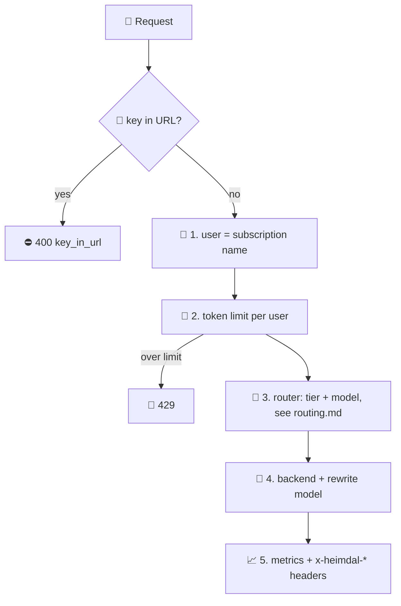

# 📜 What the APIM policies do

> 💡 **TL;DR:** Three XML policies run the gateway. [bifrost-router.xml](../policies/bifrost-router.xml) handles chat and responses: identify the caller, limit tokens, **pick a model tier**, call the backend, record everything. This page covers everything except the routing decision, which has its own page: [routing.md](routing.md). Every section shows the real policy XML, a ⚡ short answer and a 🔬 detailed one.

| 🧩 Policy | 🎯 Applies to | 🧠 What it does | 📖 Docs |
|---|---|---|---|
| [bifrost-router.xml](../policies/bifrost-router.xml) | `POST /chat/completions`, `POST /responses` | user, token limit, **router**, backend, metrics, headers | this page + [routing.md](routing.md) |
| [bifrost-embeddings.xml](../policies/bifrost-embeddings.xml) | `POST /embeddings` | rate limit, embedding model, `Embedding Tokens` metric. **No router** | [embeddings-mcp-policies.md](embeddings-mcp-policies.md) |
| [shield-mcp.xml](../policies/shield-mcp.xml) | `/mcp` of the `shield-mcp` API | rate limit, function key injection | [embeddings-mcp-policies.md](embeddings-mcp-policies.md) |

> ℹ️ The XML below is copied from the policy files. If the two ever differ, the policy file wins.

---

## 🗺️ The big picture

The order of steps in `bifrost-router.xml`. Sections 1–4 follow it.



---

## 1. 👤 Caller identity

> ⚡ **Short:** The user is the APIM subscription behind the `api-key` header. Its name (`thor`, `tony-stark`) tags every metric and response.

```xml
<!-- keys in URLs end up in logs and browser history: header only -->
<choose>
  <when condition="@(context.Request.Url.Query.ContainsKey(&quot;subscription-key&quot;))">
    <return-response>
      <set-status code="400" reason="Bad Request" />
      <set-header name="Content-Type" exists-action="override">
        <value>application/json</value>
      </set-header>
      <set-body>{"error":{"code":"key_in_url","message":"Send the subscription key in the api-key header, not in the URL."}}</set-body>
    </return-response>
  </when>
</choose>

<!-- 1. Who is calling? -->
<set-variable name="user" value="@(context.Subscription?.Name ?? &quot;anonymous&quot;)" />
```

**🔬 In detail:**
- A key in the URL gets `400 key_in_url`. A missing or unknown key never reaches the policy: APIM answers `401` first.
- `context.Subscription.Name` becomes the `user` variable. `anonymous` is only a safety net.
- The *product* of the subscription decides the token budget (section 2), not the model tier.
- Full story, including why subscriptions and not OAuth: [user.md](user.md).

---

## 2. 🔨 Token limit (Mjolnir)

> ⚡ **Short:** Each user gets a tokens-per-minute budget. Go over it and you get `429`, while other users keep working.

```xml
<choose>
  <when condition="@(context.Product?.Id == &quot;infinity-gauntlet&quot;)">
    <llm-token-limit
        counter-key="@(context.Subscription?.Id ?? context.Request.IpAddress)"
        tokens-per-minute="{{tpm-premium}}"
        estimate-prompt-tokens="true"
        remaining-tokens-header-name="x-heimdal-remaining-tokens" />
  </when>
  <otherwise>
    <llm-token-limit
        counter-key="@(context.Subscription?.Id ?? context.Request.IpAddress)"
        tokens-per-minute="{{tpm-standard}}"
        estimate-prompt-tokens="true"
        remaining-tokens-header-name="x-heimdal-remaining-tokens" />
  </otherwise>
</choose>
```

**🔬 In detail:**

| Product | Named value | Default |
|---|---|---|
| `avengers-initiative` (standard) | `tpm-standard` | 5,000 TPM |
| `infinity-gauntlet` (premium) | `tpm-premium` | 100,000 TPM |

- `counter-key` is the subscription id, so each user has their own counter.
- `estimate-prompt-tokens="true"`: APIM counts the prompt *before* the call, so a huge prompt is stopped without paying for it.
- The limit runs **before routing**. It counts tokens per user, whatever tier or model is picked later.
- `x-heimdal-remaining-tokens` shows what is left in the minute.
- Two blocks in a `choose`, because the named value is substituted as text when the policy loads, so each block needs its own static value.
- Notebook: `05_mjolnir_token_limits`.

---

## 3. 🔀 Model routing

> ⚡ **Short:** The router turns the prompt into a tier (`pym` / `stark` / `thanos`) by **length**, **complexity** (heuristic or LLM judge) or **hybrid**, and then into a model.

**🔬 In detail:** the routing has its own page with the XML for each signal: [routing.md](routing.md).

| 📏 Mode | 🧠 Signal | 📖 Section |
|---|---|---|
| `length` | estimated tokens (characters / 4) | [routing.md section 2](routing.md#2--routing-by-length) |
| `complexity` + `heuristic` | keyword score | [routing.md section 3](routing.md#3--routing-by-complexity-heuristic) |
| `complexity` + `llm` | small model as judge | [routing.md section 4](routing.md#4--routing-by-complexity-llm-classifier) |
| `hybrid` | higher of length and complexity | [routing.md section 5](routing.md#5--deciding-the-tier-length-complexity-hybrid) |

---

## 4. 🎯 Backend, model rewrite and key hygiene

> ⚡ **Short:** The policy writes the routed model into the body, picks Foundry or the local Ollama, and never forwards the client's key.

```xml
<set-variable name="isOllama" value="@(((string)context.Variables[&quot;routedModel&quot;]).Length &gt; 0 &amp;&amp; (&quot;,{{ollama-models}},&quot;).ToLowerInvariant().Contains(&quot;,&quot; + ((string)context.Variables[&quot;routedModel&quot;]).ToLowerInvariant() + &quot;,&quot;))" />
<set-variable name="isMai" value="@(((string)context.Variables[&quot;routedModel&quot;]).Length &gt; 0 &amp;&amp; (&quot;,{{mai-deployments}},&quot;).ToLowerInvariant().Contains(&quot;,&quot; + ((string)context.Variables[&quot;routedModel&quot;]).ToLowerInvariant() + &quot;,&quot;))" />
<set-body>@{
    var b = (JObject)context.Variables["body"];
    b["model"] = (string)context.Variables["routedModel"];
    // MAI models only accept max_completion_tokens (chat completions)
    if ((bool)context.Variables["isMai"] &amp;&amp; b["max_tokens"] != null) {
        b["max_completion_tokens"] = b["max_tokens"];
        b.Remove("max_tokens");
    }
    // Ollama's OpenAI surface only honours max_tokens ...
    if ((bool)context.Variables["isOllama"] &amp;&amp; b["max_completion_tokens"] != null) {
        if (b["max_tokens"] == null) { b["max_tokens"] = b["max_completion_tokens"]; }
        b.Remove("max_completion_tokens");
    }
    return b.ToString();
}</set-body>
<choose>
  <when condition="@((bool)context.Variables[&quot;isOllama&quot;])">
    <set-backend-service backend-id="asgard-ollama" />
    <set-header name="Authorization" exists-action="override">
      <value>Basic {{ollama-basic-auth}}</value>
    </set-header>
    <set-header name="ngrok-skip-browser-warning" exists-action="override">
      <value>1</value>
    </set-header>
    <set-variable name="routeReason" value="@(&quot;local-ollama;&quot; + (string)context.Variables[&quot;routeReason&quot;])" />
  </when>
  <otherwise>
    <set-backend-service backend-id="@((bool)context.Variables[&quot;isMai&quot;] ? &quot;asgard-foundry-mai&quot; : &quot;asgard-foundry&quot;)" />
    <authentication-managed-identity resource="https://cognitiveservices.azure.com" />
  </otherwise>
</choose>
<!-- never forward the client's APIM key to the backend -->
<set-header name="api-key" exists-action="delete" />
<set-query-parameter name="api-version" exists-action="delete" />
```

**🔬 In detail:**

| Routed model is in… | Backend | Auth | Extra |
|---|---|---|---|
| `ollama-models` | `asgard-ollama` (ngrok) | basic auth from `ollama-basic-auth` | `max_completion_tokens` → `max_tokens`; reason gets prefix `local-ollama;` |
| `mai-deployments` | `asgard-foundry-mai` | managed identity | `max_tokens` → `max_completion_tokens` |
| anything else | `asgard-foundry` | managed identity | – |

- The named values `ollama-models` and `mai-deployments` are comma lists. `none` means off (named values cannot be empty).
- `api-version` is deleted because the `/openai/v1` and `/mai/v1` backends do not take one.
- More on the local backend: [local-ollama.md](local-ollama.md). More on key handling: [user.md](user.md) section 4.

---

## 5. 📈 Metrics and response headers

> ⚡ **Short:** Every call is counted per user and model, and the answer carries headers that tell the client what the router did.

```xml
<llm-emit-token-metric namespace="heimdal">
  <dimension name="User" value="@((string)context.Variables[&quot;user&quot;])" />
  <dimension name="Model" value="@((string)context.Variables[&quot;routedModel&quot;])" />
  <dimension name="Tier" value="@((string)context.Variables[&quot;tier&quot;])" />
  <!-- agent tag: clients send x-agent ...; max 5 custom dimensions, so it replaces Product -->
  <dimension name="Agent" value="@(context.Request.Headers.GetValueOrDefault(&quot;x-agent&quot;, &quot;none&quot;))" />
  <dimension name="API ID" />
</llm-emit-token-metric>
```

```xml
<outbound>
  <base />
  <set-header name="x-heimdal-user" exists-action="override">
    <value>@((string)context.Variables["user"])</value>
  </set-header>
  <set-header name="x-heimdal-tier" exists-action="override">
    <value>@((string)context.Variables["tier"])</value>
  </set-header>
  <set-header name="x-heimdal-model" exists-action="override">
    <value>@((string)context.Variables["routedModel"])</value>
  </set-header>
  <set-header name="x-heimdal-route-reason" exists-action="override">
    <value>@((string)context.Variables["routeReason"])</value>
  </set-header>
</outbound>
```

**🔬 In detail:**

| 📨 Header | Meaning |
|---|---|
| `x-heimdal-user` | the subscription name |
| `x-heimdal-tier` | `pym`, `stark`, `thanos` or `explicit` |
| `x-heimdal-model` | the deployment that really answered |
| `x-heimdal-route-reason` | why: mode, estimated tokens, score, LLM tier (see [routing.md](routing.md#6--client-overrides-and-the-route-reason)) |
| `x-heimdal-remaining-tokens` | tokens left in the minute (set by `llm-token-limit`) |

- `Agent` comes from the optional `x-agent` request header. It is a tag, never an identity.
- Dashboards for these metrics: [workbook.md](workbook.md).

---

## 6. 🎛️ Changing the behaviour at runtime

> ⚡ **Short:** All routing settings are APIM named values. Change them and the next requests use them, with no redeploy.

**🔬 In detail:**

| Named value | Values | Effect |
|---|---|---|
| `router-mode` | `length` \| `complexity` \| `hybrid` | which signal decides |
| `complexity-mode` | `heuristic` \| `llm` | how complexity is measured |
| `length-threshold-tokens` | e.g. `500` | `<T` pym, `<4T` stark |
| `complexity-threshold` | e.g. `3` | `<C` pym, `<2C` stark |
| `model-tier-pym` / `-stark` / `-thanos` | deployment names | tier → model |
| `model-classifier` | deployment name | the judge model |
| `tpm-standard` / `tpm-premium` | e.g. `5000` | token budgets |

- From a notebook: `set_router(...)` in [heimdal_helpers.py](../notebooks/heimdal_helpers.py).
- APIM caches named values, so allow about a minute.
- Defaults live in [heimdal.json](../infra/config/heimdal.json). A value changed live differs from that file until the next `azd provision`.
- ⚠️ `{{name}}` is substituted as text before the C# compiles, which is why numbers are wrapped in `int.Parse("{{...}}")`. The full list of named values: [apim-definition.md](apim-definition.md).

---

## 🧭 What is not implemented

> 🚫 Ideas people ask about. None of them is in the policies today.

- Routing on **semantic** similarity or embeddings of the prompt
- Cost- or latency-aware routing, or fallback to another model on a Foundry error
- Per-tier limits (the token limit depends on the product, not on the tier)
- Blocking standard users from forcing `tier-thanos`
- Content safety checks in the policy
