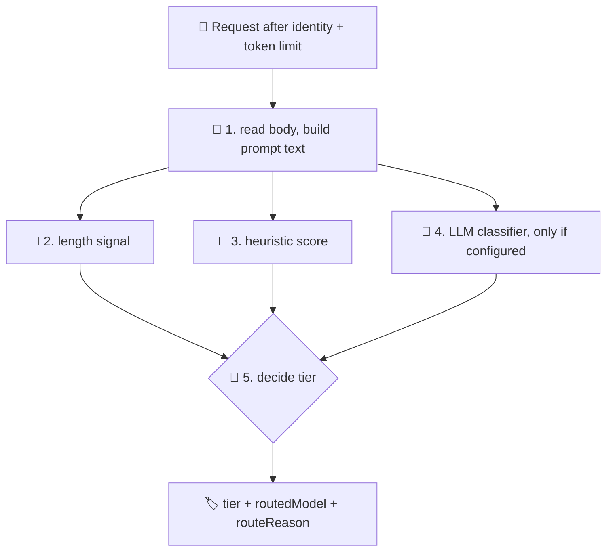
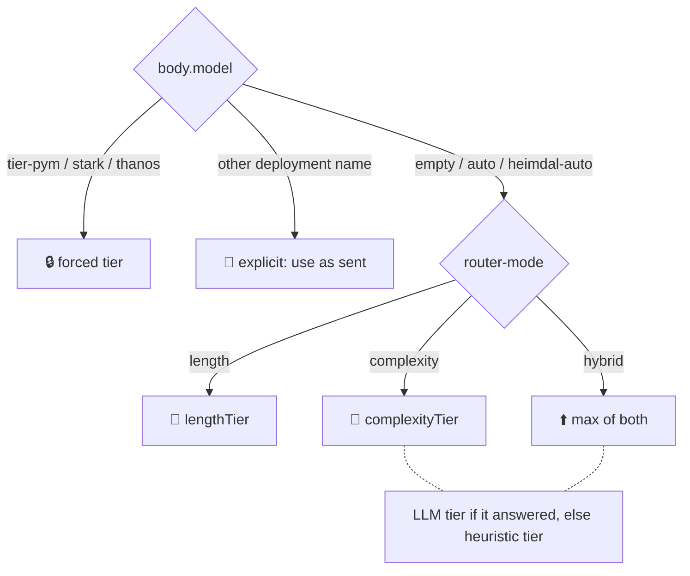

# 🔀 How the router picks a model

> 💡 **TL;DR:** The router in [bifrost-router.xml](../policies/bifrost-router.xml) turns the prompt into a **tier** (`pym` / `stark` / `thanos`) and the tier into a model. The tier comes from **length** (prompt size), **complexity** (a keyword score, or a small LLM as judge) or **hybrid** (the higher of both). Every section shows the real policy XML, a ⚡ short answer and a 🔬 detailed one.

| 🥉🥈🥇 Tier | 🧠 Default model ([heimdal.json](../infra/config/heimdal.json)) | 📏 Length rule (T = 500) | 🧮 Score rule (C = 3) |
|---|---|---|---|
| 🐜 `pym` | `gpt-6-luna` | below 500 tokens | score below 3 |
| 🦾 `stark` | `gpt-5-6-terra` | 500 up to 1,999 | 3 up to 5 |
| 🌌 `thanos` | `gpt-6-1-sol` (or `mai-thinking-1` if MAI is enabled) | 2,000 and up | 6 and up |

> ℹ️ The rest of the policy (identity, token limit, backend, metrics) is in [policies.md](policies.md). The XML below is copied from the policy; if the two ever differ, the policy file wins.

---

## 🗺️ The big picture



---

## 1. 📖 Reading the request

> ⚡ **Short:** The policy reads the body once and glues all prompt text into one string. Every signal below works on that string.

```xml
<set-variable name="body" value="@(context.Request.Body.As&lt;JObject&gt;(preserveContent: true))" />

<set-variable name="requestedModel" value="@{
    var b = (JObject)context.Variables[&quot;body&quot;];
    var m = b[&quot;model&quot;];
    return m == null ? &quot;&quot; : ((string)m ?? &quot;&quot;);
}" />
<!-- SDKs require a model, so "heimdal-auto" / "auto" mean the same as no model: the router decides -->
<set-variable name="isAuto" value="@{
    string r = (string)context.Variables[&quot;requestedModel&quot;];
    return r.Length == 0 || r == &quot;heimdal-auto&quot; || r == &quot;auto&quot;;
}" />
```

The prompt text and message count (shortened here; the policy handles `instructions`, string `input`, `messages[]` and content parts):

```xml
<set-variable name="promptText" value="@{
    var b = (JObject)context.Variables[&quot;body&quot;];
    string text = &quot;&quot;;
    var instructions = b[&quot;instructions&quot;];
    if (instructions != null &amp;&amp; instructions.Type == JTokenType.String) { text += (string)instructions + &quot;\n&quot;; }
    var input = b[&quot;input&quot;];
    if (input != null &amp;&amp; input.Type == JTokenType.String) { text += (string)input + &quot;\n&quot;; }
    var items = (b[&quot;messages&quot;] as JArray) ?? (input as JArray);
    ...   // adds every message's string content and every text part
    return text;
}" />
<set-variable name="messageCount" value="@{
    var b = (JObject)context.Variables[&quot;body&quot;];
    var items = (b[&quot;messages&quot;] as JArray) ?? (b[&quot;input&quot;] as JArray);
    return items == null ? 1 : items.Count;
}" />
```

**🔬 In detail:**
- `isAuto` is true when `model` is empty, `heimdal-auto` or `auto`. SDKs force a `model`, so `heimdal-auto` is the "decide for me" value.
- `promptText` works for both API shapes: chat completions (`messages[]`) and the Responses API (`instructions` + `input`).
- ⚠️ The **whole conversation** counts: system prompt, history and the new question. A long chat drifts towards a higher tier even if the last question is simple. Images, tool definitions and tool results are not in `promptText`.

---

## 2. 📏 Routing by length

> ⚡ **Short:** Longer prompt, bigger model. The policy estimates tokens as characters divided by 4 and compares them with `length-threshold-tokens`.

```xml
<set-variable name="promptTokens" value="@(((string)context.Variables[&quot;promptText&quot;]).Length / 4)" />
<set-variable name="lengthTier" value="@{
    int tokens = (int)context.Variables[&quot;promptTokens&quot;];
    int th = int.Parse(&quot;{{length-threshold-tokens}}&quot;);
    return tokens &lt; th ? 0 : (tokens &lt; th * 4 ? 1 : 2);
}" />
```

**🔬 In detail:**

| Prompt size | Estimated tokens | Tier (T = 500) |
|---|---|---|
| a short question (120 chars) | 30 | 🐜 `pym` |
| a pasted email (3,000 chars) | 750 | 🦾 `stark` |
| a pasted document (10,000 chars) | 2,500 | 🌌 `thanos` |

- 💡 **Why length:** cheap to compute, predictable, no extra call. Big inputs need big context windows and often a stronger model.
- ⚠️ **Limits:** `chars / 4` fits English; other languages and code tokenize differently. Length says nothing about difficulty: a long, easy text still goes up.
- 🎛️ Use it with `router-mode=length`. Notebook: `03_router_prompt_length`.

---

## 3. 🧮 Routing by complexity: heuristic

> ⚡ **Short:** The policy scores the prompt with simple rules (code, "analyze", "compare", many questions, maths). A higher score means a bigger model. It is fast and free, but only a keyword guess.

```xml
<set-variable name="complexityScore" value="@{
    string text = ((string)context.Variables[&quot;promptText&quot;]).ToLowerInvariant();
    int score = 0;

    // code or query-like content
    if (text.Contains(&quot;```&quot;) || text.Contains(&quot;def &quot;) || text.Contains(&quot;class &quot;) || text.Contains(&quot;select &quot;) || text.Contains(&quot;function &quot;)) { score += 2; }

    // reasoning / analysis verbs (max 3 points)
    string[] kw = new string[] { &quot;step by step&quot;, &quot;explain why&quot;, &quot;analyze&quot;, &quot;analyse&quot;, &quot;compare&quot;, &quot;trade-off&quot;, &quot;tradeoff&quot;,
                                 &quot;prove&quot;, &quot;derive&quot;, &quot;optimize&quot;, &quot;architecture&quot;, &quot;evaluate&quot;, &quot;design a&quot;, &quot;strategy&quot;, &quot;root cause&quot;, &quot;pros and cons&quot; };
    int hits = 0;
    foreach (var k in kw) { if (text.Contains(k)) { hits++; } }
    score += Math.Min(hits, 3);

    // several questions in one prompt
    int q = text.Split(new char[] { '?' }).Length - 1;
    if (q &gt; 3) { score += 2; } else if (q &gt; 1) { score += 1; }

    // math
    if (text.Contains(&quot;integral&quot;) || text.Contains(&quot;theorem&quot;) || text.Contains(&quot;equation&quot;) || text.Contains(&quot;probability&quot;)) { score += 1; }

    // long conversations
    if ((int)context.Variables[&quot;messageCount&quot;] &gt; 6) { score += 1; }

    return score;
}" />
<set-variable name="heuristicTier" value="@{
    int score = (int)context.Variables[&quot;complexityScore&quot;];
    int th = int.Parse(&quot;{{complexity-threshold}}&quot;);
    return score &lt; th ? 0 : (score &lt; th * 2 ? 1 : 2);
}" />
```

**🔬 In detail:** the text is lower-cased and scored. The policy computes this score on every call, so it is always available as a fallback.

| 🔎 Signal | ➕ Points | Matches (substring) |
|---|---|---|
| 💻 Code or query | +2 | `` ``` ``, `def `, `class `, `select `, `function ` |
| 🧠 Reasoning words | +1 each, **max 3** | the 16 words in `kw` |
| ❓ Several questions | +1 for 2–3 `?`, +2 for 4 or more | count of `?` |
| ➗ Maths | +1 | `integral`, `theorem`, `equation`, `probability` |
| 💬 Long conversation | +1 | more than 6 messages |

The best possible score is 9. With C = 3: below 3 is `pym`, 3 to 5 is `stark`, 6 and up is `thanos`.

| Prompt | Score | Tier |
|---|---|---|
| "What is the capital of France?" | 0 | 🐜 `pym` |
| "Compare REST and gRPC step by step and explain the trade-offs." | 3 (`compare`, `step by step`, `trade-off`) | 🦾 `stark` |
| A code block, "analyze", "architecture", "evaluate" and four questions | 7 (2 + 3 + 2) | 🌌 `thanos` |

- ⚠️ **False positives:** matching is plain substring. "first class", "function of the board" or "select a date" add code points. The score is a signal, not a judgement.
- 🎛️ Use it with `router-mode=complexity` and `complexity-mode=heuristic`. Notebook: `04_router_complexity`.

---

## 4. 🤖 Routing by complexity: LLM classifier

> ⚡ **Short:** A small, cheap model reads the prompt and answers one word: `simple`, `medium` or `complex`. That is smarter than keywords, but it costs one extra call and some latency.

```xml
<set-variable name="llmTier" value="@(-1)" />
<choose>
  <when condition="@(&quot;{{router-mode}}&quot; != &quot;length&quot; &amp;&amp; &quot;{{complexity-mode}}&quot; == &quot;llm&quot; &amp;&amp; (bool)context.Variables[&quot;isAuto&quot;])">
    <send-request mode="new" response-variable-name="classifierResponse" timeout="15" ignore-error="true">
      <set-url>@("{{foundry-openai-base}}/chat/completions")</set-url>
      <set-method>POST</set-method>
      <set-header name="Content-Type" exists-action="override">
        <value>application/json</value>
      </set-header>
      <set-body>@{
          string text = (string)context.Variables["promptText"];
          if (text.Length > 4000) { text = text.Substring(0, 4000); }
          var req = new JObject(
              new JProperty("model", "{{model-classifier}}"),
              new JProperty("max_completion_tokens", 16),
              new JProperty("messages", new JArray(
                  new JObject(
                      new JProperty("role", "system"),
                      new JProperty("content", "You are a prompt complexity classifier. Reply with exactly one word: simple (chit-chat, lookups, short factual), medium (summaries, rewrites, moderate reasoning) or complex (multi-step reasoning, code design, deep analysis).")),
                  new JObject(
                      new JProperty("role", "user"),
                      new JProperty("content", text)))));
          return req.ToString();
      }</set-body>
      <authentication-managed-identity resource="https://cognitiveservices.azure.com" />
    </send-request>
    <set-variable name="llmTier" value="@{
        try {
            var r = (IResponse)context.Variables[&quot;classifierResponse&quot;];
            if (r == null || r.StatusCode != 200) { return -1; }
            string verdict = ((string)r.Body.As&lt;JObject&gt;()[&quot;choices&quot;][0][&quot;message&quot;][&quot;content&quot;] ?? &quot;&quot;).Trim().ToLowerInvariant();
            if (verdict.StartsWith(&quot;simple&quot;)) { return 0; }
            if (verdict.StartsWith(&quot;medium&quot;)) { return 1; }
            if (verdict.StartsWith(&quot;complex&quot;)) { return 2; }
            return -1;
        } catch (Exception) { return -1; }
    }" />
  </when>
</choose>
```

**🔬 In detail:**

| Step | What happens |
|---|---|
| 1️⃣ **When it runs** | Only if `router-mode` is not `length`, `complexity-mode` is `llm` **and** the request is auto (`isAuto`). Forced tiers and named deployments skip it |
| 2️⃣ **The call** | `send-request` to `{{foundry-openai-base}}/chat/completions` with `{{model-classifier}}` (default `gpt-6-luna`), managed identity, `timeout="15"`, `max_completion_tokens` 16 |
| 3️⃣ **The prompt** | The system message above plus the prompt text, cut to the first 4,000 characters |
| 4️⃣ **The verdict** | Answer starting with `simple` → 0 (`pym`), `medium` → 1 (`stark`), `complex` → 2 (`thanos`) |
| 5️⃣ **Fallback** | Error (`ignore-error`), timeout, non-200 or an unexpected word → `llmTier = -1`, and the **heuristic tier is used instead** |

- 👁️ `x-heimdal-route-reason` ends with `llmTier=-1` when the classifier did not decide. Check it to know which signal won.
- 💸 The classifier call is a separate `send-request`. It is not part of the user's token metrics, but it is billed on the Foundry side and adds latency to every auto request. (Inferred from the policy structure, not measured.)
- ⚠️ The classifier sees only the first 4,000 characters, and its answer is not deterministic.
- 🎛️ Use it with `complexity-mode=llm`. Notebook: `04_router_complexity`.

---

## 5. 🎯 Deciding the tier (length, complexity, hybrid)

> ⚡ **Short:** `router-mode` picks which signal counts. `length` uses size, `complexity` uses difficulty, `hybrid` takes the **higher** of the two. The default is `hybrid` + `heuristic`.

```xml
<set-variable name="tier" value="@{
    string requested = (string)context.Variables[&quot;requestedModel&quot;];
    if (requested == &quot;tier-pym&quot;) { return &quot;pym&quot;; }
    if (requested == &quot;tier-stark&quot;) { return &quot;stark&quot;; }
    if (requested == &quot;tier-thanos&quot;) { return &quot;thanos&quot;; }
    if (!(bool)context.Variables[&quot;isAuto&quot;]) { return &quot;explicit&quot;; }

    string mode = &quot;{{router-mode}}&quot;;
    int lengthTier = (int)context.Variables[&quot;lengthTier&quot;];
    int llmTier = (int)context.Variables[&quot;llmTier&quot;];
    int complexityTier = llmTier &gt;= 0 ? llmTier : (int)context.Variables[&quot;heuristicTier&quot;];
    int t = mode == &quot;length&quot; ? lengthTier : (mode == &quot;complexity&quot; ? complexityTier : Math.Max(lengthTier, complexityTier));
    return t == 0 ? &quot;pym&quot; : (t == 1 ? &quot;stark&quot; : &quot;thanos&quot;);
}" />

<set-variable name="routedModel" value="@{
    string tier = (string)context.Variables[&quot;tier&quot;];
    if (tier == &quot;pym&quot;) { return &quot;{{model-tier-pym}}&quot;; }
    if (tier == &quot;stark&quot;) { return &quot;{{model-tier-stark}}&quot;; }
    if (tier == &quot;thanos&quot;) { return &quot;{{model-tier-thanos}}&quot;; }
    return (string)context.Variables[&quot;requestedModel&quot;];
}" />
```

**🔬 In detail:**



| `router-mode` | Tier is | Good when |
|---|---|---|
| `length` | `lengthTier` | you want predictable, explainable routing |
| `complexity` | LLM tier, or heuristic tier if the LLM did not answer | short prompts can be hard |
| `hybrid` (default) | `max(lengthTier, complexityTier)` | you never want a long *or* hard prompt on the small model |

Example with default settings: a 3,000-character prompt (750 tokens → `stark`) with score 7 (→ `thanos`) goes to `thanos`, because hybrid takes the maximum.

---

## 6. 🕹️ Client overrides and the route reason

> ⚡ **Short:** A client can skip the router by sending `tier-pym`, `tier-stark`, `tier-thanos` or a concrete deployment name as `model`. The `x-heimdal-route-reason` header tells you what happened.

```xml
<set-variable name="routeReason" value="@{
    string tier = (string)context.Variables[&quot;tier&quot;];
    if (tier == &quot;explicit&quot;) { return &quot;client-selected-deployment&quot;; }
    if (((string)context.Variables[&quot;requestedModel&quot;]).StartsWith(&quot;tier-&quot;)) { return &quot;client-forced-tier&quot;; }
    return &quot;mode=&quot; + &quot;{{router-mode}}&quot; + &quot;;complexity=&quot; + &quot;{{complexity-mode}}&quot;
         + &quot;;tokens~&quot; + ((int)context.Variables[&quot;promptTokens&quot;]).ToString()
         + &quot;;score=&quot; + ((int)context.Variables[&quot;complexityScore&quot;]).ToString()
         + &quot;;llmTier=&quot; + ((int)context.Variables[&quot;llmTier&quot;]).ToString();
}" />
```

**🔬 In detail:**

| `body.model` | `x-heimdal-tier` | `x-heimdal-route-reason` |
|---|---|---|
| missing, `auto`, `heimdal-auto` | `pym` / `stark` / `thanos` | `mode=hybrid;complexity=heuristic;tokens~30;score=0;llmTier=-1` |
| `tier-thanos` (any `tier-*`) | that tier | `client-forced-tier` |
| `gpt-5-6-terra` (a deployment) | `explicit` | `client-selected-deployment` |

- The token limit always applies, even with an override.
- 🧪 Demo-grade: nothing stops a standard user from forcing `tier-thanos`. The only guard is the token limit.
- Next step after the decision: backend selection, metrics and headers, see [policies.md](policies.md).
