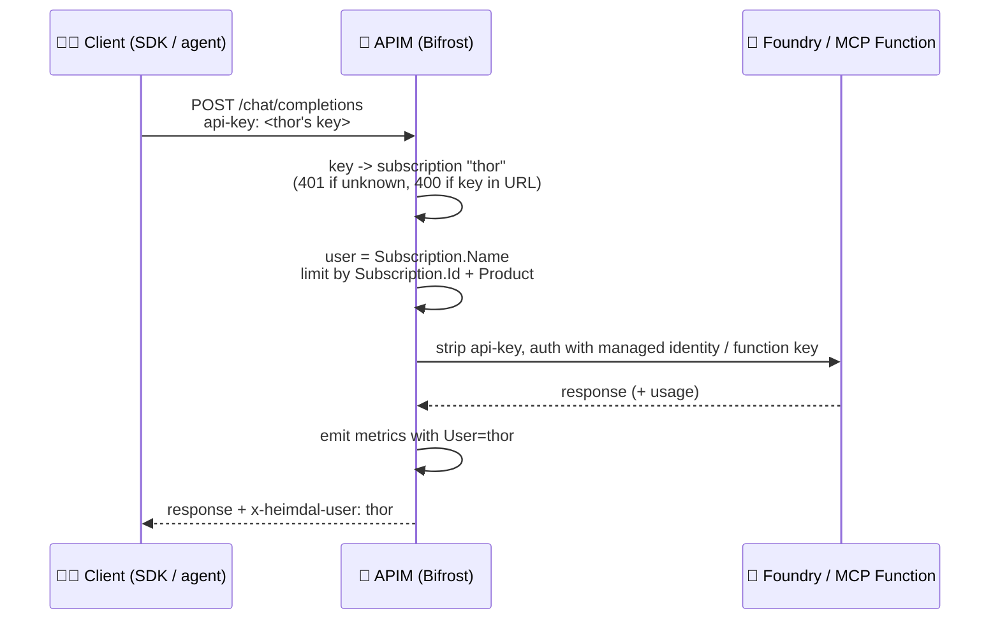

# 🛡️ How APIM identifies the user

> 💡 **TL;DR:** **The user is the APIM subscription whose key arrives in the `api-key` header.** Each demo user is one subscription. Its name is the user name, and its product sets the tier. There's no login or OAuth on purpose; see [why subscriptions](#-why-subscriptions-and-not-oauth).

| 🔑 Key | ➡️ | 👤 Subscription | ➡️ | 🎟️ Product | ➡️ | ⚡ Token limit |
|---|---|---|---|---|---|---|
| `api-key: <thor's key>` | | `thor` | | `avengers-initiative` | | 5,000 TPM |
| `api-key: <tony's key>` | | `tony-stark` | | `infinity-gauntlet` | | 100,000 TPM |

---

## 🗺️ The big picture

One call from `thor`, end to end. Sections 1–5 walk through each step.



---

## 1. 🦸 Users are APIM subscriptions

Demo users are defined once in [infra/config/heimdal.json](../infra/config/heimdal.json):

```json
"demoUsers": [
  { "name": "thor",        "product": "avengers-initiative" },
  { "name": "loki",        "product": "avengers-initiative" },
  { "name": "hulk",        "product": "avengers-initiative" },
  { "name": "black-widow", "product": "avengers-initiative" },
  { "name": "tony-stark",  "product": "infinity-gauntlet" }
]
```

[infra/modules/apim-apis.bicep](../infra/modules/apim-apis.bicep) creates one subscription for each entry. The subscription takes the user's `name` and is scoped to that user's product:

| | Product | Meaning | Token limit (named value) |
|---|---|---|---|
| 🟦 | `avengers-initiative` | Standard tier | `{{tpm-standard}}` (5,000 TPM) |
| 🟪 | `infinity-gauntlet` | Premium tier | `{{tpm-premium}}` (100,000 TPM) |

📦 `scripts/deploy.py` reads each subscription's primary key through `listSecrets` and writes it to `.env` as `HEIMDAL_KEY_<USER>` (for example, `black-widow` becomes `HEIMDAL_KEY_BLACK_WIDOW`).

> ➕ **To add a user:** add an entry to `demoUsers` and redeploy.

---

## 2. 🔑 The key travels in the `api-key` header

The `bifrost-llm` and `shield-mcp` APIs both set `subscriptionRequired: true` and look for the key in a custom header:

```bicep
subscriptionKeyParameterNames: {
  header: 'api-key'
  query: 'subscription-key'   // required by the schema; rejected by the policy
}
```

| Situation | Result |
|---|---|
| ✅ Key in the `api-key` header | Request accepted, user = subscription name |
| ⛔ Key in the URL (`?subscription-key=...`) | `400 key_in_url` from every policy, because keys in URLs end up in logs and browser history |
| 🚫 No key or an unknown key | `401` from APIM, before any policy runs |
| ⚠️ Key only in `Authorization: Bearer` | Ignored by APIM, so the request is rejected |

> 🐍 **OpenAI SDK:** the SDK sends `Authorization: Bearer <key>`, which APIM ignores. That's why `client()` in [notebooks/heimdal_helpers.py](../notebooks/heimdal_helpers.py) also sets `default_headers={"api-key": key}`.

---

## 3. ⚙️ What the policy does with the subscription

Once APIM has matched the key, the policy reads the subscription from `context.Subscription` and the product from `context.Product`:

```xml
<set-variable name="user" value="@(context.Subscription?.Name ?? &quot;anonymous&quot;)" />
```

| | What | Source | Where used |
|---|---|---|---|
| 👤 | User name (`thor`, `tony-stark`, ...) | `context.Subscription.Name` | `User` dimension of the `heimdal` metrics; `x-heimdal-user` response header |
| 🔨 | Counter key for limits | `context.Subscription.Id` (falls back to client IP) | `llm-token-limit` (chat/responses), `rate-limit-by-key` (embeddings: 120 calls/min; MCP: 30 calls/min) |
| 🎟️ | Tier | `context.Product.Id` | `infinity-gauntlet` gets `{{tpm-premium}}`, any other product gets `{{tpm-standard}}` |
| 🤖 | Agent (optional) | `x-agent` request header | `Agent` metric dimension; a tag only, never an identity |

> 🧯 The `anonymous` and IP fallbacks are a safety net. They don't occur in practice, because every API requires a subscription.

---

## 4. 🔒 The key never reaches the backend

Clients authenticate to the gateway. The gateway uses its own identity to call the backends:

- 🧠 **Foundry (LLM, embeddings):** the policy deletes `api-key` and authenticates with APIM's managed identity (`authentication-managed-identity`, `https://cognitiveservices.azure.com`).
- 🛡️ **MCP Function:** the policy deletes `api-key` and `Ocp-Apim-Subscription-Key` and injects the function key from the `{{shield-mcp-key}}` named value.
- 🦙 **Local Ollama (optional):** the policy deletes `api-key` and overrides `Authorization` with the ngrok basic-auth credentials from the `{{ollama-basic-auth}}` named value. The SDK sends the APIM key as `Authorization: Bearer`, so the override also keeps it away from the laptop.

> 👁️ Foundry, the Function and the local Ollama therefore never see who the user is. Per-user attribution exists only in APIM: metrics, response headers and gateway logs.

---

## 5. 👁️ Where you see the user (the All-Seeing Eye)

- 📨 **Response header:** `x-heimdal-user: thor`
- 📈 **Azure Monitor metrics** (namespace `heimdal`): token metrics split by `User`, `Model`, `Tier` and `Agent`
- 🔍 **Log Analytics:** `ApiManagementGatewayLogs.ApimSubscriptionId` holds the subscription name. Join it on `CorrelationId` to `ApiManagementGatewayLlmLog` to get per-user token counts (see the KQL helpers in `heimdal_helpers.py`).
- 🕷️ **Foundry agents (notebook 07):** the Foundry project connection uses the key of `foundryAgentUser` (`black-widow`), so all agent traffic is attributed to that user.

---

## 🪪 Why subscriptions and not OAuth?

🎭 **This is a demo showcase, so HEIMDAL uses subscription keys on purpose.** Users are easy to manage: add a line to `demoUsers`, redeploy, and the new user has a key. There's no app registration, no token flow and no tenant setup.

⚠️ The trade-off is demo-grade identity. Anyone who holds a subscription key acts as that user, and one key can't tell apart the different people behind it.

✅ **OAuth (Entra ID) users would work too.** None of the policies is tied to subscriptions. `llm-token-limit`, `rate-limit-by-key` and the token metrics count against whatever key or value you give them. In a production setup you would:

- 🔐 validate the caller's token with `validate-azure-ad-token`
- 👤 take the user from a token claim such as `oid` instead of `context.Subscription.Name`
- 🎟️ pick the tier from an app role or group claim instead of `context.Product`

### 🧪 Example policy (not deployed)

This would replace step 1 ("Who is calling?") and step 2 (the token limit) of [bifrost-router.xml](../policies/bifrost-router.xml):

```xml
<!-- 1. Validate the token and keep it for later expressions -->
<validate-azure-ad-token tenant-id="{{tenant-id}}" output-token-variable-name="jwt">
  <audiences>
    <audience>api://heimdal-gateway</audience>
  </audiences>
</validate-azure-ad-token>

<!-- 2. Who is calling? -->
<set-variable name="user" value="@(((Jwt)context.Variables[&quot;jwt&quot;]).Claims.GetValueOrDefault(&quot;oid&quot;, &quot;anonymous&quot;))" />
<set-variable name="isPremium" value="@(((Jwt)context.Variables[&quot;jwt&quot;]).Claims.GetValueOrDefault(&quot;roles&quot;, &quot;&quot;).Contains(&quot;Heimdal.Premium&quot;))" />

<!-- 3. Same token limit, new counter key and tier condition -->
<choose>
  <when condition="@((bool)context.Variables[&quot;isPremium&quot;])">
    <llm-token-limit counter-key="@((string)context.Variables[&quot;user&quot;])"
        tokens-per-minute="{{tpm-premium}}" estimate-prompt-tokens="true" />
  </when>
  <otherwise>
    <llm-token-limit counter-key="@((string)context.Variables[&quot;user&quot;])"
        tokens-per-minute="{{tpm-standard}}" estimate-prompt-tokens="true" />
  </otherwise>
</choose>
```

📈 The `llm-emit-token-metric` block and the `x-heimdal-user` header already read the `user` variable, so they would keep working unchanged.

You can also keep the subscription for the app or team (its tier and quota) and add the token to identify the person.

> 🚫 OAuth isn't implemented in this repo and isn't planned. This section only shows that the approach carries over.
