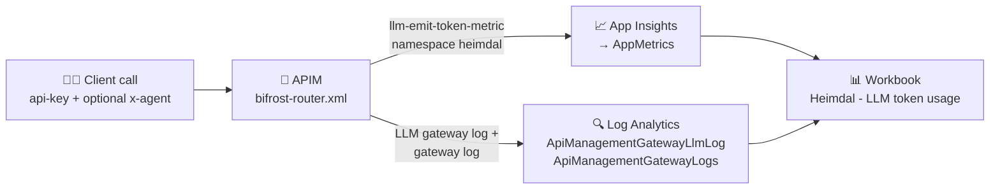

# 📊 What the Azure workbook shows

> 💡 **TL;DR:** The workbook **`Heimdal - LLM token usage`** answers one question: **who used how many LLM tokens, on which model, through which route and agent?** It has one time-range picker and 10 panels, all fed by the gateway's own telemetry in Log Analytics. Nothing is stored in the workbook itself.

| 🎯 You want to know | 📍 Look at | 🧱 Section |
|---|---|---|
| Total usage in the period | Totals | [3](#3--totals) |
| Who is spending the most | Total tokens per user, over time | [4](#4--token-usage-per-user) |
| Which models are used | Tokens per user and model, token share | [5](#5--models-used-by-user) |
| Which routing tier answered | Tokens per user and routing tier | [5](#5--models-used-by-user) |
| Exact per-request numbers | Requests and tokens per user and model | [6](#6--exact-per-request-usage) |
| Which agent caused the traffic | Tokens per agent, user and model | [7](#7--per-agent) |

---

## 🗺️ The big picture

Where the numbers come from. Two sources feed the panels.

| | Source | Table | Used by | Detail level |
|---|---|---|---|---|
| 📈 | Custom metric `llm-emit-token-metric` | `AppMetrics` | Totals, per user, per model, per tier, per agent | Aggregated, has `User`, `Model`, `Tier`, `Agent` |
| 🔍 | APIM LLM gateway log | `ApiManagementGatewayLlmLog` + `ApiManagementGatewayLogs` | "Exact per-request usage" panel | One row per request |

---

## 1. 🚪 Open the workbook

The workbook is deployed with the rest of the infrastructure by [workbook.bicep](../infra/modules/workbook.bicep). It is a shared workbook, in the same resource group as the Log Analytics workspace.

1. In the Azure portal, open **Monitor → Workbooks** (or the resource group).
2. Open **`Heimdal - LLM token usage`**.

> ⏱️ **Data lags a few minutes.** The workbook says so itself. Right after a notebook run the panels can be empty. Wait 2–5 minutes and press refresh.

> ⚠️ The workbook needs traffic first. With no calls through the gateway, every panel is empty.

---

## 2. 🎛️ The time range picker

The only filter is **Time range** at the top. Every panel uses it.

| Option | Default |
|---|---|
| 1 hour, 4 hours, 24 hours, 2 days, 7 days, 30 days, or a custom range | **24 hours** |

The time chart picks its bucket size from the range.

---

## 3. 🔢 Totals

One row with four numbers for the chosen period.

| 📌 Column | Meaning |
|---|---|
| **Total tokens** | Sum of all prompt and completion tokens |
| **Users** | Number of distinct users (APIM subscriptions) |
| **Models** | Number of distinct models that answered |
| **Agents** | Number of distinct `x-agent` values (includes `none` for calls without the header) |

---

## 4. 👤 Token usage per user

A "user" is the APIM subscription name (`thor`, `tony-stark`, ...). See [user.md](user.md).

| 📊 Panel | Chart | What you see |
|---|---|---|
| **Total tokens per user** | Bar chart | Ranking of users by total tokens, highest first |
| **Prompt vs completion tokens per user** | Bar chart | Per user, how many tokens were input (prompt) and output (completion) |
| **Total tokens over time per user** | Line chart | One line per user. Shows when each user was active and spikes |

> 💡 **Reading tip:** a user with many prompt tokens and few completion tokens sends large inputs (long documents, RAG context). The other way round means long answers.

> ⚡ These totals are what the `llm-token-limit` counts against. A user near their tier limit (5,000 TPM standard, 100,000 TPM premium) shows up as a flat top in the line chart, and the client gets `429`.

---

## 5. 🧠 Models used by user

The router can pick the model, so this section shows where requests actually went.

| 📊 Panel | Chart | What you see |
|---|---|---|
| **Tokens per user and model** | Bar chart, grouped by model | Which model each user consumed |
| **User x model breakdown (metrics)** | Table | `User`, `Model`, `Tokens`, `Calls` |
| **Token share per model** | Pie chart | Share of each model in all tokens |
| **Tokens per user and routing tier** | Table | `User`, `Tier`, `Tokens` |

### 🧭 What the `Tier` column means

`Tier` here is the **routing tier chosen by the router**, not the product tier of the user. It comes from [bifrost-router.xml](../policies/bifrost-router.xml).

| 🏷️ Value | Meaning |
|---|---|
| `pym` | Small model. Chosen for simple prompts, or forced with `model: "tier-pym"` |
| `stark` | Medium model. Chosen for medium prompts, or forced with `model: "tier-stark"` |
| `thanos` | Large model. Chosen for complex or long prompts, or forced with `model: "tier-thanos"` |
| `explicit` | The client named a deployment itself, so the router did not decide |

> ⚠️ **`Calls` is not a request count.** It counts metric data points (`count()` on `AppMetrics`). Use the "exact per-request" panel below for real request counts.

---

## 6. 🎯 Exact per-request usage

| 📊 Panel | Chart | What you see |
|---|---|---|
| **Requests and tokens per user and model** | Table | `User`, `ModelName`, `Requests`, `Prompt`, `Completion`, `Total` |

This is the only panel built from the LLM gateway log. The log has no user column. The query joins it to `ApiManagementGatewayLogs` on `CorrelationId` and uses the APIM subscription name as the user.

| ⚖️ | 📈 Metric panels (sections 3–5, 7) | 🔍 Log panel (this section) |
|---|---|---|
| Numbers | Aggregated | Exact, per request |
| Dimensions | User, Model, Tier, Agent | User, Model |
| Good for | Trends and splits | Checking and billing-style totals |

> 💡 If the metric totals and the log totals differ slightly for the same period, the cause is ingestion lag. The two sources arrive at different speeds.

---

## 7. 🤖 Per agent

| 📊 Panel | Chart | What you see |
|---|---|---|
| **Tokens per agent, user and model** | Table | `Agent`, `User`, `Model`, `Tokens`, highest first |

The `Agent` value is the `x-agent` request header. It is a **tag only, never an identity**: a client can send any value. Calls without the header show as `none`.

---

## 🚫 What the workbook does not show

| ❌ Not shown | Why |
|---|---|
| Embedding tokens | The `Embedding Tokens` metric ([bifrost-embeddings.xml](../policies/bifrost-embeddings.xml)) is emitted, but no panel queries it. Only the `Total Tokens` and the prompt/completion metrics are used |
| Cost in money | Only tokens are counted. There is no price table |
| Rate-limit hits (`429`) | Not queried. Check the gateway logs |
| Latency, errors, backend health | Out of scope. This is a token-usage workbook |
| MCP calls | The MCP API ([shield-mcp.xml](../policies/shield-mcp.xml)) emits no token metrics |

> 🧪 **Demo-grade:** the workbook has no alerts and no budgets. It is for looking at usage, not for enforcing it. Enforcement is done by the policy (`llm-token-limit`).

---

## ✅ Quick check that it works

1. Run a notebook that calls the gateway (see [story.md](../story.md)).
2. Wait a few minutes.
3. Open the workbook with the **24 hours** range.
4. Expect: **Totals** above zero, the calling user in the first bar chart, and the used model in the pie chart.
5. If a panel stays empty, see the diagnostic settings listed in [apim-definition.md](apim-definition.md) (loggers, `to-log-analytics`).
